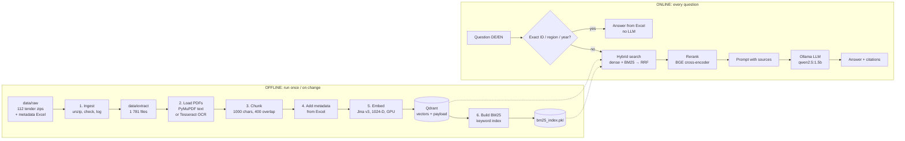
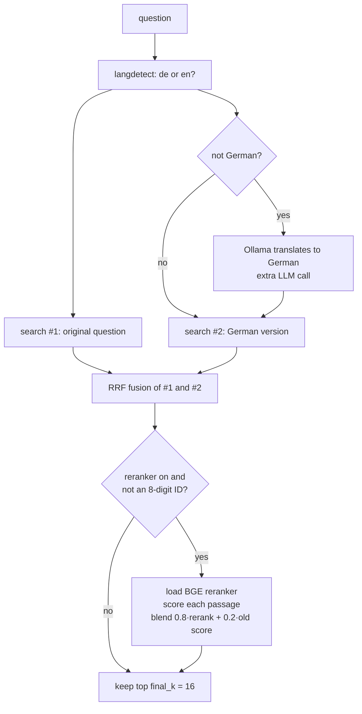

# Tender RAG — The Whole Project Explained

**Written:** 4 Nov 2026 · **Describes:** the code as it is today, on branch `chore/repo-cleanup` (commit `b858ecb`), before any Tender RAG 2.0 changes.
**Read with:** [PROJECT_DEFINITION.md](PROJECT_DEFINITION.md) (what we will build and measure) and [PORTFOLIO_MASTER_PLAN.md](PORTFOLIO_MASTER_PLAN.md) (career context).

Every statement about the code below comes from reading the source files; file and function names are given so you can check. Nothing here has been run yet: the services (Docker/Qdrant, Ollama) are not running on this machine, so **runtime behaviour is still unmeasured**.

---

## Contents
1. [What the project is, and why it exists](#1-what-the-project-is-and-why-it-exists)
2. [The big picture: two pipelines](#2-the-big-picture-two-pipelines)
3. [Offline pipeline: from zip files to a searchable index](#3-offline-pipeline-from-zip-files-to-a-searchable-index)
4. [Online pipeline: from a question to an answer](#4-online-pipeline-from-a-question-to-an-answer)
5. [One question, traced end to end](#5-one-question-traced-end-to-end)
6. [Why each component exists (and what replaces it if it fails)](#6-why-each-component-exists)
7. [Everything that is wrong today, ranked](#7-everything-that-is-wrong-today-ranked)
8. [What we learned from the six reference projects](#8-what-we-learned-from-the-six-reference-projects)
9. [What the job market asks for (Nov 2026)](#9-what-the-job-market-asks-for-nov-2026)
10. [Reference projects found online](#10-reference-projects-found-online)
11. [Where this leaves us](#11-where-this-leaves-us)

---

## 1. What the project is, and why it exists

**In one sentence:** a private, local question-answering system over German public-tender documents. You ask in German or English, and it answers from the documents and shows the sources.

**The business problem:** companies that bid for public contracts in Germany receive "Vergabeunterlagen", a zip of 10–100 files per tender: scanned PDFs, construction plans, Word forms, GAEB bills of quantities (`.X83/.D83`). A bid manager has to find the deadline, the issuing authority, the required declarations (e.g. *Formblatt 124 Eigenerklärung*), the work package and the risks, for every tender. That takes hours.

**Why a RAG system and not just an LLM:**
- The answers live in *these specific documents*, not in the model's training data. **Retrieval** brings the right passages; **generation** writes the answer from them. That is RAG = Retrieval-Augmented Generation.
- Answers must be **traceable** (which file, which page), because people make bidding decisions on them.
- Tenders change daily. Updating an index is cheap; retraining a model is not.

**Why local / privacy-first:** tender documents and a company's bidding interest are commercially sensitive. Everything runs on your machine: Qdrant for search, Ollama for the LLM, the embedding model on your GPU. No document leaves the computer. A 2026 trend article on German companies moving to local RAG pipelines supports this choice ([tech-insider.org](https://tech-insider.org/de/warum-deutsche-unternehmen-2026-auf-lokale-rag-pipelines-setzen/)).

**The data:** 112 DTAD tenders from April 2023, in `data/raw/<tender_id>/`. 105 zips are valid and 7 are truncated downloads. There is also one metadata spreadsheet (`VUDb_Data_2025-07-13_11-12-07.xlsx`) with title, date, region and issuing authority per tender. Unzipped, this becomes **1 781 files**: 1 488 PDF, 103 DOCX, 107 GAEB (`x83/d83/p83`), 41 nested zips, 13 XLSX, plus a few others.

---

## 2. The big picture: two pipelines

Every RAG system has two halves:

- The **offline pipeline** runs once, or whenever documents change. It turns files into a searchable index.
- The **online pipeline** runs on every question. It searches the index and writes an answer.

**Entry points:**

| How you run it | File | What it does |
|---|---|---|
| `python scripts/data_processing/ingest.py` | ingestion | Steps 1 (+ Excel cleaning) |
| `python scripts/data_processing/embed.py --mode fresh\|append\|ocr-only` | indexing | Steps 2–5 |
| `python scripts/deployment/build_bm25_index.py` | keyword index | Step 6 |
| `streamlit run ui/streamlit/app.py` | chat UI | Online pipeline, version A |
| `uvicorn src.api.main:app` → `POST /api/v1/search`, `POST /api/v1/chat` | REST API | Online pipeline, version B |
| `docker compose up` | Qdrant 1.9.2 on port 6333 | Vector database |

All settings live in one place: `src/core/config.py` (`AppConfig`, overridable with `RAGBOT_*` environment variables).

---

## 3. Offline pipeline: from zip files to a searchable index

### Step 1 — Ingest (`scripts/data_processing/ingest.py` → `src/core/io.py`)

**What happens**
1. `ZipIngestor.run()` walks `data/raw` for `*.zip`. For each zip it computes a **SHA-256 hash** and skips it if the hash is already in `data/state/zip_manifest.json`, so nothing is processed twice.
2. `_extract_zip()` writes every member to `data/extract/<member name>`. A member that is itself a zip is **extracted recursively**.
3. `_analyse_file()` labels each file: allowed extension? (`.pdf .docx .d83 .dwg .jpg .png .tiff .zip .txt`), size ≤ 100 MB?, language of the first page (`langdetect`). The result is appended to `data/logs/ingest_YYYY-MM.csv` with the **root zip name**.
4. `copy_loose_files()` copies non-zip files from `raw` to `extract`.
5. `ExcelCleaner.run()` takes the newest `.xlsx` in `data/raw`, normalises column names (`DTAD ID` → `dtad_id`), and writes `data/metadata/cleaned_metadata.{csv,xlsx}`.

**Why:** you can't search zips. Hashing makes re-runs cheap. The log gives an audit trail of what came from where.

**Problems found**
- 🔴 **Tender identity is lost.** Files are written to `data/extract/<name>`, **not** `data/extract/<tender_id>/<name>`. Measured from the zips (CRC comparison, 4 Nov 2026; nested zips not counted): **101 file paths appear in more than one tender**. For **66 of them the content differs between tenders** (159 file versions get overwritten, e.g. `VHB_214_Besondere_Vertragsbedingungen.pdf` exists in 9 different versions); **35 are byte-identical**, so there only the tender link is lost. The later tender **overwrites** the earlier one, so tender-specific documents silently disappear from the index, and no document knows which tender it belongs to. The only link left is the `root_zip` column in the CSV log.
- 🔴 **Path traversal** (`io.py:135`): a zip member named `../../something` would be written outside `data/extract`. There is also no limit on zip bombs or nesting depth.
- 🟡 The allowed-extension list says `.d83` but not `.x83/.p83/.xlsx`, so most GAEB files are labelled "invalid_format" in the log even though they were extracted.

### Step 2 — Load PDFs (`src/core/io.py` → `PDFLoader.load_pages`)

**What happens**, per page:
1. PyMuPDF (`fitz`) extracts the digital text layer.
2. If the page has **< 50 characters**, it is probably a scan. It is rendered at **300 DPI** and passed to **Tesseract OCR** (`--oem 1 --psm 6`, German + English).
3. The text is cleaned. Pages with ≤ 10 characters are dropped. Each page becomes a `DocumentPage(page_number, text, source_path, meta={"used_ocr": ...})`.

**Why:** many tender PDFs are scans of stamped, signed forms. Without OCR they would be invisible. The 50-character rule avoids slow OCR on pages that already have text.

**Problems found**
- 🔴 **Only PDFs are indexed.** `Indexer.build()` does `rglob("*.pdf")`. The **103 DOCX forms, 107 GAEB files and 13 Excel sheets are never searchable**, and GAEB files hold the actual bill of quantities (what work, how much).
- 🟡 Tables become plain text lines; columns and rows lose their structure.
- 🟡 OCR quality is never measured (no character error rate), and the `used_ocr` flag is not used anywhere later.

### Step 3 — Chunk (`src/core/index.py` → `PageAwareChunker`)

**What happens:** the page texts of one PDF are concatenated and cut into chunks of **1 000 characters** with **400 characters of overlap** (`config.chunk_size / chunk_overlap`). Each chunk remembers `page_start` and `page_end`.

**Why chunk at all:** embedding models have an input limit, and a small chunk gives a precise match and a precise citation. **Why overlap:** a fact cut in half at a boundary still appears whole in one chunk.

**Problems found**
- 🟡 It cuts by character count: mid-word, mid-sentence, through tables. It has no idea of headings or sections.
- 🟡 40 % overlap means ~1.7× more chunks to embed and store than necessary, and many near-duplicate search results.
- 🟡 A chunk spanning pages 3–4 is cited as "p3-4", so you can't tell which page holds the fact.

### Step 4 — Add metadata (`src/core/io.py` → `ExcelMetadataJoiner.enrich`)

**What happens:** it tries to find the tender ID for a chunk, first from the chunk's metadata, then from **the digits in the file name** (first 8). If that ID is in the Excel sheet, the row (title, date, region, authority…) is merged into the chunk's payload.

**Why:** so you can filter by tender, region or date, and show the title next to a source.

**Problem found**
- 🔴 Extracted file names are things like `124.pdf` or `VHB_212_Teilnahmebedingungen.pdf`, with **no tender ID in the name** (see Step 1). So for most chunks the join finds nothing, and the payload has no `dtad_id`. That breaks every tender-level feature downstream.

### Step 5 — Embed and store (`src/core/index.py` → `Indexer`)

**What happens**
1. Loads **`jinaai/jina-embeddings-v3`** at a **pinned revision** (so the remote code can't change under you), on the GPU if available, with fp16 autocast.
2. Prefixes each chunk with `"search_document: "`, encodes it, normalises it, and keeps **1 024 dimensions**.
3. Builds a Qdrant point: **ID = UUID5(sha1(file) + chunk index)**. That ID is deterministic, so re-indexing the same file overwrites instead of duplicating. **Payload** = source path, chunk index, pages, merged metadata, and the first 1 500 characters of text.
4. Upserts in buffers of 1 000 points to the collection `tender_docs_jina-v3_d1024_fresh` (cosine distance, HNSW `m=16, ef_construct=64`).

**Why Jina v3:** multilingual (German *and* English questions find German text), long input (8 192 tokens), strong retrieval scores, runs locally. **Why Qdrant:** fast vector search with payload filters, runs in Docker, and supports hybrid search natively in newer versions.

**Problems found**
- 🔴 **Probably the wrong way to call Jina v3.** Its model card says retrieval needs `task="retrieval.passage"` for documents and `task="retrieval.query"` for questions. Those switch on special retrieval adapters, with built-in prompts like *"Represent the query for retrieving evidence documents: "*. Our code passes **no task** and prepends `"search_query: " / "search_document: "`, which is the convention of a *different* model (nomic). If confirmed, every search so far ran without the retrieval adapters. → First thing to test in experiment E3.
- 🔴 `embed.py --mode` **defaults to `fresh`**, which **deletes the whole collection** before re-indexing.
- 🟡 IDs come from SHA-1 of the file; if a file changes, its old chunks stay in the index (stale duplicates), and nothing removes chunks of deleted files.

### Step 6 — Build the keyword index (`scripts/deployment/build_bm25_index.py` → `src/core/hybrid_search.py`)

**What happens:** it reads **every point back out of Qdrant** (`scroll`), tokenises the text (`tokenize_german`: lower-case, split on non-word characters, drop ~45 German stop-words), builds a **BM25Okapi** index in memory with `rank_bm25`, and saves it as `data/state/bm25_index.pkl` (7.8 MB).

**Why BM25 at all:** vector search understands *meaning* but is weak on **exact strings**: tender IDs, form numbers ("Formblatt 124"), CPV codes, GAEB position numbers, rare technical words. BM25 scores exact word overlap. Combining both is **hybrid search**.

**Problems found**
- 🟡 No German **compound splitting or stemming**: "Baustelleneinrichtung" never matches "Baustelle", and "Angebote" doesn't match "Angebot".
- 🟡 The whole corpus lives in RAM, must be rebuilt from scratch after every re-index, and nothing checks it's in sync with Qdrant.
- 🟡 **Pickle** files execute code when loaded. Fine for a file you made yourself; never load one you didn't.

---

## 4. Online pipeline: from a question to an answer

There are **two different online pipelines**, the Streamlit UI and the REST API. They share retrieval but use **different prompts, thresholds and answer logic**. That is a design problem in itself, because the same question can get different answers.

### 4.1 Retrieval core (`src/core/qa.py` → `retrieve_candidates`)

Each "search" is `search_hybrid_cached` → `search_hybrid` (`src/core/search.py`):

1. **Dense:** embed the question (cached in an LRU cache of 1 000), search Qdrant for the top `limit` results. **`limit` is the final count (16 in the UI, the request's `top_k` in `/chat`), not the configured pool `topk_candidate = 100`**, because `qa.py:116` passes its final limit down (defect 22). If the question contains a tender ID ("DTAD-ID 20046891", "Tender …", or just 8 digits), it first tries a **payload filter on the field `id`**.
2. **BM25:** score all chunks with the keyword index, take the top `limit` (same small number, see above), then fetch those points from Qdrant by ID.
3. **RRF (Reciprocal Rank Fusion):** each result gets `1/(60 + rank)` from each list it appears in, and the scores are summed. Results found by both methods rise to the top. RRF is popular because it needs no score calibration: it uses ranks, not raw scores.
4. The whole hybrid result is cached by `md5(question + limit)`.

**Why each step:** two languages → the dual query lets an English question find German text, even though Jina is already multilingual. Hybrid → meaning plus exact terms. Reranker → a **cross-encoder** reads question and passage *together* and judges relevance much better than vector similarity, but it is too slow to run on the whole corpus, so it only re-orders the top candidates.

**Problems found**
- 🔴 **Exact-ID search can't work:** the filter uses payload field `id`, but chunks store `dtad_id`, and for most chunks not even that (Step 4). The filter always returns nothing and silently falls back. This explains the weak exact-ID results in the old evaluation.
- 🔴 **BM25 ranks are scrambled:** Qdrant's `retrieve()` returns points in arbitrary order, not BM25 order, so RRF fuses the wrong ranks.
- 🔴 **The reranker model is loaded from disk on every single question** (`FlagReranker(...)` inside the function), and any error is silently ignored.
- 🟡 **Scores on different scales are mixed:** RRF keeps each object's *original* score (cosine ≈ 0–1, BM25 ≈ 0–30), and the reranker blends that with its own 0–1 score. Thresholds like the UI's `0.35` therefore compare unrelated numbers.
- 🟡 The cache ignores the index version, so after re-indexing it can return stale results.
- 🟡 At import time `qa.py` loads a **second copy** of the 570 M-parameter embedding model, just to check dimensions.

### 4.2 Version A: Streamlit UI (`ui/streamlit/app.py` → `answer_with_rag`)

1. **Metadata route first** (`lookup_metadata`). Any 7–8 digit number → look up that DTAD-ID in the Excel and answer directly. A year or a known region in the question → list up to 5 matching tenders. **No LLM is used**, so it is fast and can't hallucinate.
2. Otherwise `retrieve_candidates` → top-K hits.
3. If there are no hits, or the top score is < 0.35 → reply **"Not in the tender data."**
4. Otherwise build the prompt: an English system prompt ("answer ONLY from the context, cite [1], [2]…, same language as the question"), the last K turns of chat **memory**, the numbered context, and the question. Send it to Ollama. Show sources with page numbers and a download button.

**Problems:** any 7–8 digit number is treated as a tender ID, so a question about **CPV code 45000000** answers "Not in the tender data". Chat text is rendered as **raw HTML** (`unsafe_allow_html`). The import shim points at `ui/` instead of the project root, so `from core.config` likely fails unless `PYTHONPATH` is set.

### 4.3 Version B: REST API (`src/api/`)

- `main.py`: FastAPI app, CORS for Streamlit, request timing header, global error handler, `/health`.
- `security.py`: header `X-API-Key` must equal `RAGBOT_API_KEY`, **default `dev-key-12345`**. In-memory rate limit of 60 requests/minute per key.
- `POST /api/v1/search` (`routes/search.py`): mode `hybrid | dense | bm25`. BM25 mode returns IDs with **empty content**.
- `POST /api/v1/chat` (`routes/chat.py`): calls `retrieve_candidates` **and then** `answer_query`, which **retrieves again**. `top_k` is ignored for the answer. `answer_query` builds a **German** prompt from up to 16 hits but **cuts the context to 3 000 characters** (≈ the first 3 passages), then asks `qwen2.5:1.5b` (256 tokens max, temperature 0.2). `stream: true` is accepted but not implemented.

---

## 5. One question, traced end to end

**Question:** *"Welche Eigenerklärungen muss der Bieter für Tender 20046645 abgeben?"* ("Which self-declarations must the bidder submit for tender 20046645?")

| Step | What happens today | Consequence |
|---|---|---|
| UI metadata route | Finds "20046645" (8 digits) → looks it up in Excel → **returns title/date/region/authority and stops** | The actual question (which declarations?) is never answered |
| *(via API instead)* language | `de` → no translation; the "second" search is identical and comes from the cache | Harmless, but needless code path |
| Dense search | `detect_tender_id` → filter `id == "20046645"` → **0 results** (field doesn't exist) → unfiltered search | Results from **any** tender |
| BM25 | Tokens: `welche, eigenerklärungen, bieter, tender, 20046645, abgeben`. "20046645" appears in no chunk text, and "eigenerklärungen" ≠ "eigenerklärung" | Mostly matches generic form text, from many tenders |
| RRF | Fuses dense with BM25 in **scrambled order** | Fusion is partly random |
| Rerank | Loads BGE from disk (seconds), re-orders | Slow; the best passages may be about Formblatt 124 of **another** tender |
| Answer | German prompt, context cut to 3 000 chars, qwen2.5 1.5B | Plausible-sounding answer that may describe the wrong tender, with citations that look right |

This example is exactly the kind of failure that the gold questions (`G-DE`, categories "exact ID + content" and "multi-doc") must catch, and that the first fixes must solve.

---

## 6. Why each component exists

| Component | Why it is there | Main alternative | What will decide it (experiment) |
|---|---|---|---|
| SHA-256 manifest | Don't reprocess unchanged zips | Re-run everything | Keep; extend to per-file versions |
| PyMuPDF text layer | Fast, exact text for digital PDFs | Docling, Unstructured, MinerU | E1: extraction accuracy, speed |
| Tesseract OCR fallback | Scanned pages would be empty | PaddleOCR, Docling OCR | E1: character error rate on OCR-DE |
| Char chunker 1000/400 | Simple, keeps page numbers | Section/layout-aware chunks, tables as units | E2: Recall@k, citation precision |
| Jina v3 embeddings | Multilingual DE/EN, long input, local | bge-m3 (dense + sparse in one model) | E3: Recall@k, MRR on G-DE |
| Qdrant | Vector search + filters, local, hybrid-capable | pgvector, OpenSearch, Weaviate | Keep; use its native hybrid |
| BM25 (rank_bm25 + pickle) | Exact IDs and terms | Qdrant sparse vectors (BM25/bge-m3 sparse) | E4: exact-ID recall, latency |
| RRF fusion | Combines rankings without score tuning | Weighted score fusion (DBSF) | E4 |
| Dual query + LLM translation | English question → German docs | Rely on multilingual embeddings only | E4: EN-question recall vs. extra latency |
| BGE reranker v2-m3 | Better relevance ordering | None; or Jina reranker | E5: quality gain vs. added ms |
| Metadata route (Excel) | Exact facts without an LLM: fast, no hallucination | — | Keep, fix the regex, add a "metadata + content" route |
| Ollama + qwen2.5:1.5b | Private, free, runs on an 8 GB GPU | 3B/7B local, one hosted model for comparison | E6: correctness, faithfulness, latency |
| FastAPI + API key + rate limit | Programmatic access, basic protection | — | Keep; real auth later |
| Streamlit | Quick demo UI | — | Keep for v1, but behind the API |
| LRU caches | Repeat questions return fast | Version-aware cache | Make the cache key include the index version |

---

## 7. Everything that is wrong today, ranked

The 12 issues from the first audit, plus 10 new ones (★) found while writing this document. **Defect 22 (added later):** ★ the candidate pool equals the final count (`qa.py:116`), so `topk_candidate = 100` is never used online and the reranker only sees 5 to 16 results.

**P0: data loss and security (fix first)**
1. ★ **Tender identity lost; 101 shared file paths, 66 with differing content (159 versions overwritten)** during extraction (Step 1)
2. Zip path traversal, no zip-bomb or depth limits (`io.py:135`)
3. `fresh` mode (the default) deletes the Qdrant collection
4. Hard-coded fallback API key `dev-key-12345`
5. Chat text rendered as raw HTML in Streamlit

**P1: retrieval and answer correctness**
6. ★ **Only PDFs are indexed**: 103 DOCX, 107 GAEB, 13 XLSX ignored
7. ★ **Jina v3 called without its retrieval task** (probable; verify)
8. ★ Exact-ID filter uses a payload field that doesn't exist (`id` vs `dtad_id`)
9. ★ Metadata join fails for most chunks (no ID in file names)
10. BM25 rank order lost before RRF
11. Reranker reloaded on every query; errors swallowed
12. `/chat` retrieves twice; `top_k` ignored
13. Context cut to 3 000 characters
14. ★ Scores from different scales mixed; thresholds meaningless
15. ★ Any 7–8 digit number is treated as a tender ID (CPV codes break)
16. ★ Two online pipelines with different prompts and refusal texts

**P2: performance, maintainability, packaging**
17. Second embedding model loaded at import
18. ★ Caches ignore the index version (stale answers after re-index)
19. ★ BM25 has no German compound splitting or stemming
20. Packaging: `pyproject.toml` packages `core` (should be `src`), missing deps (fastapi, uvicorn, rank_bm25), UI import shim
21. Garbled import line in `qa.py`

**Important consequence:** the old evaluation (`evaluation/EVALUATION_REPORT.md`, 30.6 % "retrieval quality") measured a system with issues 1, 6, 7, 8 and 10 active at once. The baseline must be re-measured with proper metrics **before** fixing, and the fixes should be applied **one at a time**, each with its own before/after number. That is how you learn *why* each change matters.

---

## 8. What we learned from the six reference projects

| Reference | The lesson | Where it lands in our pipeline |
|---|---|---|
| **Clinical-RAG** (German gynecology guidelines) | Publish **frozen evaluation numbers** in `reports/`: recall with and without the reranker (0.50 → 0.83 there), refusal on trap questions, one exact refusal sentence | Steps 4.1/4.2 → one refusal text; E5 reranker report; trap questions in G-DE |
| **8hr-MARATHON** | Production shell: clean folders, **tests for auth, rate-limit, retries, health**, CI (ruff + pytest), Locust load test, `/metrics`, retries with backoff | API (4.3), new `tests/`, CI, load tests (E10) |
| **ATLAS** | **Graph:** guard → retrieve → (no evidence ∣ generate) → validate. **Permission filter inside the vector query.** Database tables for documents (status, version), audit, feedback | Evidence check before generating; ACL in Qdrant payload; document versions (fixes P2-18) |
| **IT-Support Copilot** | **Grade the evidence → rewrite the query once → refuse honestly**; return the decision trace to the UI | Replaces the meaningless score thresholds (P1-14) |
| **pdichone production course** | Patterns for error handling, security, testing, cost and checkpointing. Lesson files, not an architecture. | Reference while writing tests and the agent in Project 2 |
| **Codebasics AI System Design** (bonus) | Numbers before boxes; route each request to the cheapest approach that works; version-aware caches; fallback model; the pre-launch checklist | Metadata route = "cheapest approach"; cache fix; SLOs |

**Shared lesson from all six:** none of them has messy, scanned, multi-format German documents. They use clean markdown or a handful of PDFs. **Our hard part (ingestion, OCR, GAEB, tender identity) is exactly what they skip.** That is our differentiator, if we measure it.

---

## 9. What the job market asks for (Nov 2026)

**Measured signals.** Different samples and methods, so treat them as directional:
- In an analysis of **390 AI-engineer postings (Jul 2026)**: LLMs 63 %, Python 59 %, **evals 56 %**, agents 50 %. Evals outranked every classical ML framework ([DEV Community](https://dev.to/ali_82f3409ed625e8ba8515b/ai-engineer-roadmap-2026-what-390-job-postings-actually-require-3jdo); a small, self-published sample).
- Across broader AI/ML postings, generative AI, LLM and RAG each appear in **14–18 %**, and Python in 77 % ([Simpleapply](https://simpleapply.ai/blog/ai-ml-engineer-job-market-2026)).
- Agentic-AI skills grew from **0.06 % to 0.23 %** of all US postings from 2024 to 2025, per Lightcast data cited for the Stanford AI Index 2026 ([Second Talent](https://www.secondtalent.com/resources/most-in-demand-ai-engineering-skills-and-salary-ranges/)). Small share, fast growth.
- LangChain and RAG are named as the common LLM tooling in AI-engineer postings ([ODSC](https://opendatascience.com/12-in-demand-ai-job-roles-2026-how-to-get-hired/)).

**Germany specifically:** postings ask for RAG in production, Python + FastAPI, vector databases, Docker (Kubernetes "nice to have"), *one* cloud, and often on-premise/local models for data-protection reasons. A typical example is a remote Senior GenAI Engineer (LLMs, RAG, Python) role on join.com ([Talents2Germany](https://join.com/companies/talents2germany/16299059-senior-genai-engineer-llms-rag-python-w-m-d-remote-in-de)). Tender-document AI is a real business case; Open Telekom Cloud describes one, hosted in Germany ([Open Telekom Cloud](https://open-telekom-cloud.com/en/blog/references/document-extraction-using-ai)).

**What this means for Tender RAG 2.0:**

| Market asks | Tender RAG 2.0 proves it with |
|---|---|
| Evals (56 %) | Gold set G-DE, retrieval + answer + citation metrics, CI gate, frozen reports |
| RAG in production | Fixed pipeline, latency SLOs, load tests, Docker |
| Document AI / OCR | Parser and OCR comparison with CER/WER (E1) |
| Vector DB + hybrid search | Qdrant native hybrid, exact-ID route (E4) |
| Privacy / on-prem | Fully local stack, no data leaves the machine |
| Python, FastAPI, Docker, CI | One clean API, tests, GitHub Actions |
| Agents (50 %) | Project 2 (MultiDoc Evidence Agent), using P1's search as an MCP tool |

---

## 10. Reference projects found online

Stars and activity checked on GitHub on 4 Nov 2026.

**Complete RAG platforms (study the architecture, don't copy it)**

| Project | ★ | Learn from it |
|---|---|---|
| [langgenius/dify](https://github.com/langgenius/dify) | 160k | Product-level RAG + workflow app; how a polished UX handles sources |
| [infiniflow/ragflow](https://github.com/infiniflow/ragflow) | 93k | **Closest to us:** deep document understanding, layout and tables, chunk templates, citations |
| [onyx-dot-app/onyx](https://github.com/onyx-dot-app/onyx) | 33k | Enterprise search: connectors, **document-level permissions**, hybrid search (also authors of EnterpriseRAG-Bench) |
| [deepset-ai/haystack](https://github.com/deepset-ai/haystack) | 27k | Clean pipeline abstraction, evaluation built in; often recommended for production |
| [Cinnamon/kotaemon](https://github.com/Cinnamon/kotaemon) | 26k | Document chat UI with **in-document citation highlighting**: a good model for our source viewer |
| [weaviate/Verba](https://github.com/weaviate/Verba) | 7.7k | Compact hybrid-search RAG app |
| [truefoundry/cognita](https://github.com/truefoundry/cognita) | 4.4k | Modular RAG with an MLOps mindset (less active since Mar 2026) |

**Document parsing and OCR (for experiment E1)**

| Project | ★ | Use |
|---|---|---|
| [docling-project/docling](https://github.com/docling-project/docling) | 70k | Layout + tables + reading order; first challenger to PyMuPDF |
| [PaddlePaddle/PaddleOCR](https://github.com/PaddlePaddle/PaddleOCR) | 92k | OCR challenger to Tesseract for scans |
| [opendatalab/MinerU](https://github.com/opendatalab/MinerU) | 83k | PDF → markdown/JSON; alternative to Docling |
| [Unstructured-IO/unstructured](https://github.com/Unstructured-IO/unstructured) | 16k | Broad file-type coverage (DOCX, XLSX…), relevant to fix P1-6 |

**Evaluation and observability**

| Project | ★ | Use |
|---|---|---|
| [confident-ai/deepeval](https://github.com/confident-ai/deepeval) | 19k | Answer, faithfulness and agent tests in pytest style |
| [explodinggradients/ragas](https://github.com/explodinggradients/ragas) | 16k | RAG metrics (repo now under vibrantlabsai; last push Feb 2026) |
| [langfuse/langfuse](https://github.com/langfuse/langfuse) | 37k | Self-hosted tracing (keeps data local) |
| [Arize-ai/phoenix](https://github.com/Arize-ai/phoenix) | 12k | Alternative tracing + experiments |

**Benchmarks (verified to exist)**
- [EnterpriseRAG-Bench](https://github.com/onyx-dot-app/EnterpriseRAG-Bench): 500k synthetic enterprise docs, 500 questions in 10 categories (English text only)
- [OmniDocBench](https://github.com/opendatalab/OmniDocBench): parsing/OCR benchmark, CVPR 2025 (English/Chinese)
- [HERB](https://arxiv.org/abs/2506.23139): heterogeneous enterprise deep search
- [From BM25 to Corrective RAG](https://arxiv.org/abs/2604.01733): hybrid + rerank best on text-and-table documents

**German-language RAG (small, but useful to see)**
- [micheldumontier/gba-rag](https://github.com/micheldumontier/gba-rag): QA over German Federal Joint Committee documents with Ollama (3★)
- [crs/ollama-rag-de](https://github.com/crs/ollama-rag-de): German PDF RAG with source references (1★)
- GermanRAG dataset and Avemio German RAG models on Hugging Face

**The gap:** a limited repository search found **no open-source RAG project for German public-tender documents**. That is not proof that none exists. Present Tender RAG 2.0 as a specific technical and domain-focused contribution ("here is how I built it and measured it"), not as a first-of-its-kind claim.

---

## 11. Where this leaves us

1. **The pipeline is complete end to end**: ingestion, OCR, chunking, embeddings, hybrid search, reranking, LLM, API and UI all exist. That is more than most portfolio RAG projects.
2. **But five P1 issues hit retrieval at its root:** tender identity (1), PDF-only indexing (6), Jina task (7), ID filter (8), BM25 order (10). The system can look like it works while answering from the wrong tender.
3. **Next (Stage 0):** start Docker + Ollama, run the system **unchanged**, write G-DE v0 (40 questions, including questions like §5's), and record `reports/baseline_v0.md`.
4. **Then fix one issue at a time** in the order of §7. Each fix gets a test, a before/after number, and a short "why" note (ADR). After the P0 fixes and fix 1, a **full re-index** is required, because tender identity has to be rebuilt from the zips.

---

### Sources
- Code: this repository at commit `b858ecb`.
- Jina v3 usage: [model card](https://huggingface.co/jinaai/jina-embeddings-v3) and its `config_sentence_transformers.json` (tasks `retrieval.query` / `retrieval.passage`).
- Market: [DEV Community: 390 postings](https://dev.to/ali_82f3409ed625e8ba8515b/ai-engineer-roadmap-2026-what-390-job-postings-actually-require-3jdo) · [Simpleapply](https://simpleapply.ai/blog/ai-ml-engineer-job-market-2026) · [Second Talent / Lightcast](https://www.secondtalent.com/resources/most-in-demand-ai-engineering-skills-and-salary-ranges/) · [ODSC](https://opendatascience.com/12-in-demand-ai-job-roles-2026-how-to-get-hired/) · [365 Data Science](https://365datascience.com/career-advice/career-guides/ai-engineer-job-outlook-2025/) · [Axial Search: 10,000+ posts](https://axialsearch.com/insights/ai-ml-engineering-jobs/) · [Talents2Germany posting](https://join.com/companies/talents2germany/16299059-senior-genai-engineer-llms-rag-python-w-m-d-remote-in-de) · [tech-insider.org: local RAG in Germany](https://tech-insider.org/de/warum-deutsche-unternehmen-2026-auf-lokale-rag-pipelines-setzen/) · [Open Telekom Cloud: tender document AI](https://open-telekom-cloud.com/en/blog/references/document-extraction-using-ai)
- Framework overviews: [Firecrawl: 15 open-source RAG frameworks](https://www.firecrawl.dev/blog/best-open-source-rag-frameworks) · [Olostep](https://www.olostep.com/blog/open-source-rag-frameworks) · [Top 10 RAG frameworks by stars, Jan 2026](https://florinelchis.medium.com/top-10-rag-frameworks-on-github-by-stars-january-2026-e6edff1e0d91)
- German RAG: [awesome.ecosyste.ms: gba-rag](https://awesome.ecosyste.ms/projects/github.com%2Fmicheldumontier%2Fgba-rag) · [ollama-rag-de](https://github.com/crs/ollama-rag-de) · [GermanRAG](https://awesome.ecosyste.ms/projects/github.com%2Frasdani%2Fgermanrag)
