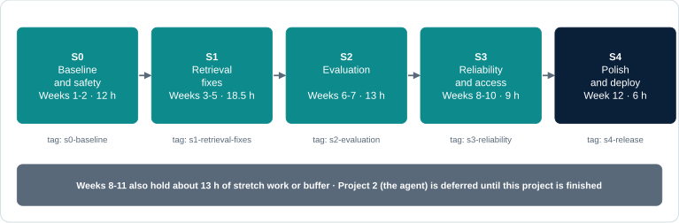
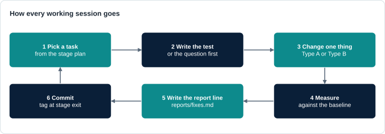
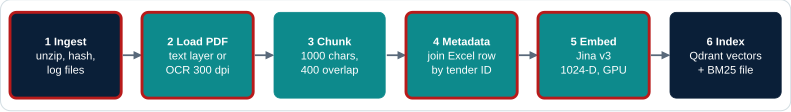
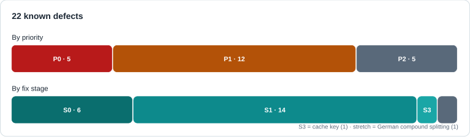
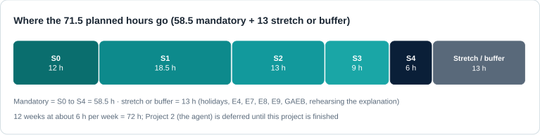
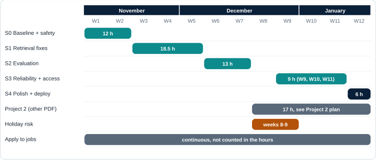
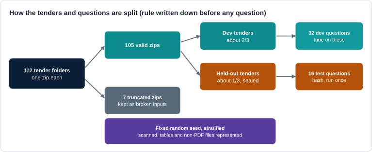
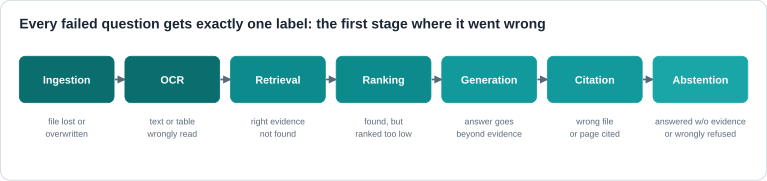
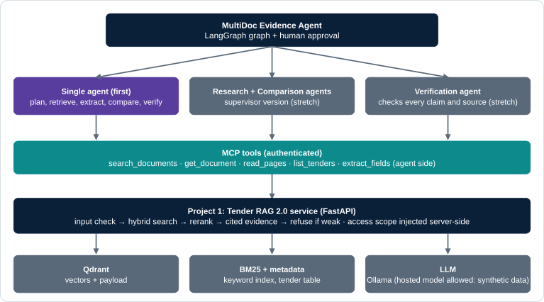

<p align="center"></p>

# 🏛️ Tender RAG 2.0 · Project Reference

> **The single reference file for the current project.** Private, measured question answering over German public tenders: fix it, measure it, prove it. The agent project (`PROJECT_2_MULTIDOC_AGENT.pdf`) is deferred until this one is finished. **Need to explain the project to someone? Start with [🗣️ Explain it in five minutes](#sec-explain).** **Want to understand the code first? Read the [🗺️ Code tour](#sec-tour).** **Choosing an answer model? See [🤖 model options](#sec-models).** This file has the same content as `PROJECT_1_TENDER_RAG_2_0.pdf`, laid out for reading.

| 📁 **112** | ✅ **105** | 📄 **1,781** | 🐞 **22** | ❓ **48** | ⏱ **58.5 h** |
|:-:|:-:|:-:|:-:|:-:|:-:|
| tenders | valid zips | extracted files | known defects | test questions | mandatory hours |

**Version 1.2** · 4 Nov 2026 · branch `chore/repo-cleanup` · **Status:** *plan. Part 1 describes the code as read, not as run. Nothing is built or measured yet.*

## 🚦 Status board

> ▶ **Now:** S0 · task 1 · back up `data/raw`  *(edit this line and the bars as you go, then commit)*

| Stage | What | Weeks | Hours | Progress | Exit tag |
|---|---|:-:|:-:|---|---|
| [S0](#stage-s0) | Baseline and safety | 1–2 | 12 | ▱▱▱▱▱▱▱▱▱▱ 0 % | `s0-baseline` |
| [S1](#stage-s1) | Retrieval fixes | 3–5 | 18.5 | ▱▱▱▱▱▱▱▱▱▱ 0 % | `s1-retrieval-fixes` |
| [S2](#stage-s2) | Evaluation | 6–7 | 13 | ▱▱▱▱▱▱▱▱▱▱ 0 % | `s2-evaluation` |
| [S3](#stage-s3) | Reliability, scale, access control | 8–10 | 9 | ▱▱▱▱▱▱▱▱▱▱ 0 % | `s3-reliability` |
| [S4](#stage-s4) | Polish and deploy | 12 | 6 | ▱▱▱▱▱▱▱▱▱▱ 0 % | — |
| — | Stretch work or buffer (E4, E7, E8, E9, GAEB, holidays) | 8–11 | 13 | optional | — |

<details>
<summary>▸ <b>How to read this file</b></summary>

- 🔴 🟠 ⚪ = defect priority P0 / P1 / P2 · `- [ ]` = a task you tick (`- [x]`) when done · ▮ = hours in that week · ▸ = click to expand.
- Sections 10 to 14 are the **stages**: each has a tick-box task list, tests, outputs and an exit gate. Everything else is background and method.
- Numbers about the system come from reading the code; targets marked **TBD** are set from the baseline.
- To track progress: tick boxes in the stage you are in, move the bar above, commit the file.

</details>

## ▶ Start here: your first session (about 3 hours)

- [ ] **1. Back up `data/raw`** to external storage. It is the only copy of the tenders. Example: `robocopy "D:\Projects\multilingual-ragbot\data\raw" "E:\backup\tender_raw" /E`, then verify checksums.
- [ ] **2. Pull the baseline model:** `ollama pull qwen2.5:1.5b`. The baseline must use today's default model; the 3B model comes later for experiment E5. Close other programs that use the GPU (2.2 GB of the 8 GB were already in use).
- [ ] **3. Start Docker Desktop**, then `docker compose up -d` and `curl http://localhost:6333/collections` (read-only). Does the old collection `tender_docs_jina-v3_d1024_fresh` still exist? That decides baseline option A (read-only) or B (isolated rebuild).
- [ ] **4. Environment:** Python 3.12 with uv, fix `pyproject.toml`, add Makefile, ruff and pre-commit; run the existing tests as they are and note what passes.
- [ ] **5.** Corpus inventory (S0 task 4), then the remaining S0 tasks in order.

> 🧱 **Restructure later, not first.** The baseline must measure today's code unchanged. Order: baseline, security fixes, then restructure inside S1 (factory and dependency injection, one piece at a time, tests first).

## 🔁 How every working session goes

<p align="center"></p>


<a id="contents"></a>

## 🧭 Contents

**🟦 PART 1 · OVERVIEW AND CURRENT STATE**<br>
[📌 1. Summary and status](#sec-1) · [ Explain it in five minutes](#sec-explain) · [🎯 2. Problem, users and scope](#sec-2) · [🗂️ 3. The data](#sec-3) · [🧩 4. The system today](#sec-4) · [🐞 5. Known defects (22)](#sec-5) · [ Code tour: understand the code first](#sec-tour)

**🟩 PART 2 · TARGETS AND LESSONS**<br>
[💼 6. Job targeting for this project](#sec-6) · [🧠 7. Lessons from the reference projects](#sec-7) · [🎤 8. Interview-question map](#sec-8)

**🟧 PART 3 · STAGES**<br>
[🧭 9. Stage overview and schedule](#sec-9) · [🧱 10. Stage S0: Baseline and safety](#stage-s0) · [🔧 11. Stage S1: Retrieval fixes](#stage-s1) · [🔬 12. Stage S2: Evaluation](#stage-s2) · [🛡️ 13. Stage S3: Reliability, scale and access control](#stage-s3) · [🚀 14. Stage S4: Polish and deploy](#stage-s4)

**🟪 PART 4 · METHOD**<br>
[📐 15. Evaluation protocol](#sec-15) · [🧪 16. Experiments](#sec-16) · [ Answer-model options for German and English](#sec-models) · [⚙️ 17. Reliability, scaling, observability and security](#sec-17)

**🟥 PART 5 · SCOPE, OUTPUTS AND DECISIONS**<br>
[📦 18. Mandatory, stretch, risks and cut order](#sec-18) · [🏁 19. Deliverables, evidence and interview stories](#sec-19) · [🔌 20. Interface for a later agent project (deferred)](#sec-20) · [📝 21. Decision log and next steps](#sec-21) · [📚 22. Sources and verification status](#sec-22) · [📖 23. Glossary](#sec-23) · [🧾 Appendix: decision record template](#sec-appendix)


---

## 🟦 PART 1 · OVERVIEW AND CURRENT STATE

*What the project is, the data, the system as it is today, and what is wrong with it*

<a id="sec-1"></a>

### 📌 1. Summary and status

> ✅ **Decision.** Upgrade the existing German tender RAG system in place into a measured, reliable, production-style service. The order is fixed: **evaluation first, reliability second, scaling third**. Every change has a reason, a test and a before/after number. The mandatory work is 58.5 hours across S0 to S4 over 12 weeks; about 13 more hours are stretch work or buffer. The agent project (Project 2) is deferred until this one is finished.

| Item | Value |
|---|---|
| Repository | multilingual-tender-rag (this repository, upgraded in place; its git remote still uses the old name ragbot-core, which GitHub redirects) |
| What it is | Private question answering over 112 German public tenders, with page-level citations, in German and English |
| Roles it targets | AI Engineer, GenAI Engineer, RAG / Document-AI Engineer (junior to 3 years); evidence also useful for Forward Deployed Engineer roles |
| Core evidence | Before/after retrieval metrics, citation precision, refusal and false-refusal rate, failure analysis per stage, p95 latency at 1/5/20 users |
| Stack | Python, FastAPI, Qdrant, Jina embeddings v3, BM25, BGE reranker, Ollama, pytest, Docker, GitHub Actions, Langfuse or Phoenix |
| Hours | S0 12 · S1 18.5 · S2 13 · S3 9 · S4 6 = 58.5 h mandatory, plus about 13 h of stretch work or buffer (at 6 h per week) |
| Machine | RTX 4060 Laptop GPU with 8 GB; Python 3.14 installed (project needs a 3.12 environment); Docker installed but stopped; Ollama not installed |

> ⚠️ **Honest status.** Everything about the current system comes from reading the source code. Qdrant and Ollama are not running on this machine, so nothing has been executed and no quality number exists. The old 30.6 % “retrieval quality” in `evaluation/EVALUATION_REPORT.md` came from heuristic manual scoring; it is not a Recall@k. All targets here are marked TBD until the baseline is measured.


#### What is new in version 1.2

- **Separate documents:** this project and the future agent project are now two PDFs; `docs/TENDER_RAG_REFERENCE.md` holds this project's content as Markdown. The older plan files were merged into it.
- **From the review:** read-only or isolated baseline; test questions sampled by held-out tender and sealed with a hash; code fixes (Type A) and corpus changes (Type B) measured separately; manual citation checks; supersession needs evidence; failure-analysis table; mandatory versus stretch split.
- **From the interview question sets:** false-refusal rate; aggregation questions through the metadata route; a cross-language experiment; re-indexing into a new collection with an alias; version tags in every trace; an injection test document; a CI evaluation gate; a passages-per-answer sweep; a contextual chunk header (stretch); an access-control filter promoted to mandatory.
- **From the jamwithai course repository:** factories and dependency injection (they also fix the reranker and embedder reloads), a test layout of unit, api and integration, Makefile, ruff and pre-commit, a git tag per stage, a ready Langfuse compose template, a cache key from all request parameters, and two stretch experiments (BM25 inside Qdrant, chunk-size sweep).
- **Focus:** Project 2 (the agent) is deferred until this project is finished; its 17 hours become slack, used for stretch experiments, holiday buffer and rehearsing how to explain the project.

<sub>[↑ Contents](#contents)</sub>

<a id="sec-explain"></a>

###  Explain it in five minutes

If someone asks “what is this project?”, use this page. Say the pitch first, walk the diagram from left to right, then the folders, then the decisions. Everything here is detailed later in the numbered sections.

> ⚠️ **Rule for honesty.** Today the code exists but the evaluation and the fixes are planned. Until reports/ contains numbers, say what is planned and why, not what was achieved. Once a number exists, quote it with the report it came from.


#### The 30-second pitch

> 💡 **Pitch.** Public tenders in Germany arrive as zips of 10 to 100 files, many of them scanned. I built a private question-answering system over 112 of them that runs fully on my own machine: you ask in German or English and get an answer with the file and page, or an honest refusal. While checking it I found it could answer from the wrong tender, so I measure everything against a question set with a sealed test split, fix one defect at a time, and keep a report for every change.


#### The five-minute story, in seven steps

| Step | What to say | Evidence in this document |
|---|---|---|
| 1 The problem | A bid manager spends hours per tender finding deadlines, authorities, required declarations and risks. The answers are in the documents, not in a language model's memory, and decisions need the exact page. | Section 2 |
| 2 The data | 112 tenders from DTAD: 105 readable zips, about 1,160 PDFs with 10,358 pages at the top level, 8 % of pages are scans, plus 106 Word files and 85 GAEB bills of quantities. | Section 3 |
| 3 The pipeline | Offline: unzip, read text (OCR only for scans), cut into chunks, embed, store in Qdrant. Online: route exact IDs to a table, otherwise search with vectors and keywords, rerank, then answer with sources. | Section 4 |
| 4 What was wrong | Reading the code and comparing file checksums showed that tenders were unzipped into one shared folder, so 159 file versions were overwritten and chunks lost their tender. The search also used a candidate pool of only 5 to 16 results, and the embedding model appears not to be called in its retrieval mode (to be tested in E2). | Section 5 |
| 5 How it is fixed safely | Baseline first, read-only. Then one change at a time, each with a test and a before/after number. Code fixes and data changes are measured separately. | Sections 10 to 11 |
| 6 How it is proven | 48 questions in 8 categories, 16 of them sealed for the final test, hand-checked citations, a failure label for every wrong answer, and a refusal rate that also counts wrongly refused questions. | Sections 12 and 15 |
| 7 How it stays reliable | New index per change with an alias switch, version tags in every trace, a cache that knows the index version, an access filter, an injection test and a load test at 1, 5 and 20 users. | Sections 13 and 17 |


#### Architecture: what each box is for

| Box | What it does | Why it is there | If it fails or is removed |
|---|---|---|---|
| Safe ingest | Unzips each tender into its own folder with path and size checks; logs every file | Zips are untrusted input; the tender identity must survive | Broken zips are quarantined; wrong-tender answers return |
| Parser and OCR | Reads the text layer; OCR only for pages with almost no text; also Word and Excel | 8 % of pages are scans; OCR everything would waste hours | Scanned pages become invisible |
| Chunker | Cuts text into 1,000-character pieces and remembers file and page | Models have input limits; small pieces give precise citations | Whole documents are too coarse to cite |
| Metadata table (Excel) | Answers IDs, counts and lists without a language model | Exact facts must never be guessed | Counting questions get hallucinated answers |
| Embeddings and Qdrant | Jina v3 vectors with tender and page in the payload; one collection per index version | Finds meaning across German and English; filters by tender | Paraphrased questions are missed |
| BM25 keyword search | Scores exact words, IDs and form numbers | Vectors are weak on exact strings | Questions like “Formblatt 124” are missed |
| Fusion and reranker | Merges the two rankings (RRF), then a cross-encoder re-orders the best 100 | Better ordering than either list alone | Right passage found but ranked too low |
| Answer step (Ollama) | Prompt with numbered sources, refuses when evidence is weak | Answers must be grounded and citable | Plausible but unsupported text |
| API and UI | FastAPI with a key and rate limit; Streamlit chat on top | One entry point, same answer everywhere | UI and API disagree |
| Traces and reports | Every request is traced with version tags; every change has a report | You can diagnose any wrong answer and reproduce any number | No way to prove an improvement |
| Evaluation harness | Runs the question file and scores retrieval, answers, citations and refusals | The only way to know whether a change helped | Progress is a feeling, not a number |


#### Folder structure: why each folder exists

**Today** (the repository as it is):

```text
multilingual-tender-rag/
├── src/
│   ├── core/            config, io (zip, PDF, OCR, Excel), index, search, hybrid_search, qa
│   └── api/             FastAPI: main, security, routes (search, chat), request/response models
├── scripts/             command-line entry points: ingest, embed, build BM25, validation
├── ui/streamlit/        chat UI
├── tests/               7 test files
├── evaluation/          old manual evaluation, query lists, old results
├── docs/                this reference, stage PDFs, diagrams, planning images
├── data/                NOT in git: raw zips, extracted files, metadata, state, logs
├── docker-compose.yml   Qdrant
└── pyproject.toml, requirements.txt, README.md
```

**Target** (a proposal, reached gradually inside S1; names are not final):

```text
src/
├── main.py              app and lifespan: builds every client once at start-up
├── dependencies.py      get_* helpers that read the clients from app.state
├── config.py            settings (RAGBOT_* environment variables)
├── routers/             thin HTTP layer: health, search, ask
├── schemas/             request and response models
└── services/
    ├── ingestion/       safe_unzip, pdf_loader (OCR), docx_loader, xlsx_loader, tender_metadata
    ├── indexing/        chunker, indexer (new collection plus alias)
    ├── retrieval/       dense, bm25, fusion (RRF), reranker, id_router
    ├── llm/             ollama_client, prompts/ (versioned)
    ├── cache/           cache key with index version and prompt version
    └── tracing/         structured traces with version tags
tests/                   unit/  api/  integration/
evaluation/              gold/ (dev.jsonl, test.jsonl, split.json), run_eval.py
reports/                 baseline_v0, fixes, retrieval_comparison, failure_analysis, load_test
scripts/                 thin command-line wrappers
data/                    not in git
```

| Rule | Reason |
|---|---|
| Routers stay thin; the work lives in services | Services can be tested without a web server |
| One place creates the clients (lifespan), everything else receives them | Fixes the reranker and embedder reloads and makes tests easy to fake |
| ingestion, indexing, retrieval and llm are separate | Each can be swapped and measured on its own (E1 to E9) |
| evaluation/ and reports/ are first-class folders | The project is judged by its evidence, not only its code |
| data/ never enters git | The tenders are not ours to publish; only scripts, questions and a small sample are |
| Restructure after the baseline, one piece at a time | The baseline must measure today's code unchanged |


#### The main decisions and why

| Decision | Why | Alternative considered | What will decide it |
|---|---|---|---|
| Everything runs locally | Private documents; German companies prefer local pipelines | Hosted LLM and embedding APIs | Quality gap of a small local model (E5) |
| Qdrant for vectors | Filters, local, native hybrid support | pgvector, OpenSearch | Kept unless a test shows a problem |
| Hybrid search (vectors + BM25) | IDs and form numbers need exact matching | Dense only | E1 |
| Cross-encoder reranker | Large ordering gain in comparable projects | No reranker | E1: gain against added latency |
| Jina v3 called with its retrieval task | Model card says retrieval needs the task; our code did not use it | bge-m3 | E2 |
| Parse once, keep pages, OCR only scans | 8 % of pages need OCR; parsing is slow | OCR everything, parse on every index | Corpus inventory; E4 |
| One folder per tender, tender ID in every chunk | Fixes wrong-tender answers and the 159 overwritten versions | Shared folder (today) | S1 Type B result |
| IDs and counts from a table, not the LLM | Exact answers, no hallucination | RAG for everything | Aggregation questions in the set |
| Evaluation before features; sealed test split | Prove improvements; avoid tuning to the test | Demo-driven development | Section 15 |
| Refuse on weak evidence; verify citations by hand | People bid on these answers | Always answer | False-refusal and citation precision |
| New collection plus alias for every re-index | Rollback and no downtime | Delete and recreate | Alias test |
| Version tags in traces and in the cache key | Reproducible numbers, no stale answers | No versioning | Cache-key test |


#### Questions people ask, with short answers

| Question | Short answer |
|---|---|
| Why not just ask ChatGPT? | The answers are in private, specific documents, and each answer needs a file and a page. Retrieval gives the evidence; the model only writes from it. |
| Why RAG and not fine-tuning? | Tenders change daily and answers need citations. Updating an index is cheap; retraining a model is not. |
| How do you know it works? | A 48-question set with a sealed test split, hand-checked citations and a failure label for every wrong answer. Until the reports exist, say this is the plan. |
| What was the hardest bug? | Tender identity: tenders were unzipped into one folder, overwriting 159 file versions, found by comparing file checksums across zips. |
| How do you stop hallucinations? | Refuse when evidence is weak, verify citations, and measure both wrong answers and wrongly refused questions. |
| What about scanned pages? | About 8 % of pages need OCR. Tesseract reads them; its error rate is measured on 10 hand-transcribed pages. |
| English questions on German documents? | Multilingual embeddings; experiment E6 compares them with translating the question first. |
| How does it scale? | Planned load test at 1, 5 and 20 users. Search should scale; answer generation on one 8 GB GPU will queue, and that saturation point is the result to report. |
| What would you do next? | Contextual chunk headers, BM25 inside Qdrant, and an agent that compares several tenders (the deferred second project). |
| What are the limits? | A small local model, 112 tenders, no GAEB completeness yet, a small question set (only large differences are meaningful), and results only as good as the hand-checked labels. |

<sub>[↑ Contents](#contents)</sub>

<a id="sec-2"></a>

### 🎯 2. Problem, users and scope

**Business problem.** Companies that bid for public contracts in Germany receive “Vergabeunterlagen”: a zip with 10 to 100 files per tender (scanned PDFs, plans, Word forms, GAEB bills of quantities). A bid manager must find the deadline, the issuing authority, the required declarations (for example Formblatt 124 Eigenerklärung), the work package and the risks for every tender. This takes hours.

**Why RAG and not only an LLM.** The answers live in these specific documents, not in a model's training data. Retrieval brings the right passages, generation writes the answer from them. Answers must be traceable to a file and a page, because people make bidding decisions on them. Tenders change daily: updating an index is cheap, retraining a model is not.

**Why local.** Qdrant, Ollama and the embedding model all run on one machine, so no question or passage leaves the computer. German postings and a 2026 trend article describe the same preference for local pipelines.

**The general problem behind it.** Organisations hold large, messy, multi-format, multi-language collections and need answers that are complete, correct, traceable and honest when evidence is missing or contradictory, and that stay that way as the collection and the number of users grow. Recent research shows this is not solved:

| Study | Finding | What it means for us |
|---|---|---|
| HERB, Salesforce, EMNLP 2025 Industry (39,190 enterprise artifacts) | Best agentic RAG method averaged 32.96; retrieval was the main bottleneck | Measure retrieval completeness, not only answer fluency |
| EnterpriseRAG, arXiv 2608.11584 (983 cases, 13 LLMs) | Best model 83.8 % on single constraints but 26.8 % on all together; flagged contradictions in under 45 % of cases; refused correctly at most 42.7 % | Test conflicts and refusals explicitly |
| From BM25 to Corrective RAG, arXiv 2604.01733 (23,088 questions) | Hybrid retrieval plus reranking was best (Recall@5 0.816); BM25 beat dense retrieval on financial text and tables | Compare BM25, dense, hybrid and reranked on our own questions |
| EnterpriseRAG-Bench, arXiv 2605.05253 | About 500,000 documents, 500 questions; English text only, no PDFs or scans | Optional later; it cannot test OCR or layout |


#### Users and tasks

- **Exact lookup:** “Show tender 20046645”: deterministic, no LLM, must never hallucinate.
- **Question answering** over one or several tenders, German or English, with file and page citations, or an honest refusal.
- **Aggregation and listing:** “How many tenders in region X in 2023?”: answered from the metadata table, not by RAG.
- **Comparison** of two to four tenders on deadline, authority and required declarations (the basis for Project 2).
- **Primary user:** a bid manager screening tenders. **Secondary:** a reviewer who checks the sources.


#### Scope

| In scope (mandatory, section 18) | Not in scope |
|---|---|
| Safe reproducible pipeline; baseline; retrieval fixes; 48-question evaluation set with sealed test split; retrieval and answer comparison; claim-level citation checks; failure analysis; access-control filter; injection test; load test at 1/5/20 users; Docker; CI; one AWS workflow | Fine-tuning models; Kubernetes; multi-region deployment; a public web service; corpus growth beyond the 112 tenders; agents (Project 2) |

<sub>[↑ Contents](#contents)</sub>

<a id="sec-3"></a>

### 🗂️ 3. The data

| Item | Verified fact (checked on disk, 4 Nov 2026) |
|---|---|
| Tenders | 112 folders in `data/raw`, one zip each, from DTAD (April 2023 packages), plus one metadata spreadsheet (VUDb_Data_2025-07-13) |
| Zip health | 105 zips are valid; 7 are truncated downloads (20044887, 20046902, 20046916, 20046935, 20046979, 20046996, 20047346), kept as real broken-input test fixtures |
| Unzipped content | 1,781 files in `data/extract`: 1,488 PDF, 103 DOCX, 107 GAEB (62 x83, 33 d83, 12 p83), 41 nested zips, 13 XLSX, a few other types |
| Size | about 1.4 GB raw, 1.8 GB extracted |
| Path collisions | Measured from the zips by CRC: 101 file paths occur in more than one tender; for 66 the content differs (159 file versions overwritten), 35 are byte-identical. Nested zips not counted |
| Metadata | Excel columns include DTAD ID, title, date, region, issuing authority, source URL (cleaned into `data/metadata/cleaned_metadata.xlsx`) |
| Back-up | **`data/raw` is the only copy of the tenders.** The legacy prototype code is archived outside the repository at D:/Projects/_archive/legacy_rag_prototypes_2025.zip |

<sub>[↑ Contents](#contents)</sub>

<a id="sec-4"></a>

### 🧩 4. The system today


#### Architecture at a glance

The **offline** half runs once or when documents change and turns files into a searchable index. The **online** half runs on every question. Red outlines mark steps with known defects (section 5).


##### Offline: files to index

<p align="center"></p>


##### Online: question to answer

<p align="center"></p>


#### Entry points

| Command | File | What it does |
|---|---|---|
| docker compose up -d | `docker-compose.yml` | Starts Qdrant 1.9.2 on port 6333 |
| python `scripts/data_processing/ingest.py` | `scripts/data_processing/ingest.py` | Unzips, logs, cleans the Excel, triggers indexing. **Default mode is fresh (destructive)** |
| python `scripts/data_processing/embed.py` `--mode` MODE | `scripts/data_processing/embed.py` | Chunks, embeds and upserts PDFs. MODE is fresh, append or ocr-only; **default fresh deletes the collection** |
| python `scripts/deployment/build_bm25_index.py` | `scripts/deployment/build_bm25_index.py` | Reads all chunks from Qdrant and writes `data/state/bm25_index.pkl` |
| uvicorn src.api.main:app `--port` 8000 | `src/api/main.py` | REST API: /health, /api/v1/search, /api/v1/chat |
| streamlit run `ui/streamlit/app.py` | `ui/streamlit/app.py` | Chat UI (uses core.qa directly, not the API) |
| pytest tests/ | tests/ (7 files) | Caching, API, ID lookup, multilingual tests (pass status not yet verified) |

#### Module map

<details>
<summary>▸ <b>Click to expand</b></summary>

| Path | Role |
|---|---|
| `src/core/config.py` | Settings (pydantic-settings); every field can be overridden by an environment variable with prefix RAGBOT_ |
| `src/core/io.py` | ZipIngestor (extract, hash, log), ExcelCleaner, PDFLoader (PyMuPDF + Tesseract OCR), ExcelMetadataJoiner |
| `src/core/index.py` | PageAwareChunker and Indexer (Jina v3, Qdrant upsert, collection handling) |
| `src/core/search.py` | Dense search, RRF, hybrid search, query embedding cache, tender ID detection |
| `src/core/hybrid_search.py` | BM25Index (rank_bm25, German tokenizer, pickle save and load) |
| `src/core/qa.py` | retrieve_candidates (language routing, fusion, reranking) and answer_query (prompt and Ollama call) |
| `src/core/domain.py`, `logger.py` | DocumentPage and DocumentChunk data classes; pipeline logger |
| `src/api/` | FastAPI app, X-API-Key check, 60 requests per minute limit, search and chat routes, request and response models |
| scripts/ | data_processing (ingest, embed, unified processor), deployment (BM25 build, deploy script), evaluation (hybrid validation) |
| `ui/streamlit/app.py` | Streamlit chat, metadata route, sources panel |
| evaluation/ | Manual and RAGAS evaluation scripts, query lists, old results, `EVALUATION_REPORT.md` |
| docs/ | This reference, the two stage PDFs, planning images, architecture diagram (`docs/references` is local only) |


</details>

#### Settings that matter (`src/core/config.py`)

<details>
<summary>▸ <b>Click to expand</b></summary>

| Setting | Current value | Note |
|---|---|---|
| llm_model | qwen2.5:1.5b | Small; compared with a 3B model in E5 |
| embed_model / embed_dim | jinaai/jina-embeddings-v3 / 1024 | Revision pinned in code; called without the retrieval task (defect 7) |
| chunk_size / chunk_overlap | 1000 / 400 characters | 40 % overlap roughly doubles the chunk count |
| topk_candidate / final_k | 100 / 16 | topk_candidate is never used online (defect 22) |
| use_hybrid / dual_query | True / True | Dual query translates non-German questions to German with the LLM (E6) |
| use_rerank / reranker_model | True / BAAI/bge-reranker-v2-m3 | rerank_keep 24, rerank_weight 0.8 |
| qdrant_collection | tender_docs_jina-v3_d1024_fresh | Override with `RAGBOT_QDRANT_COLLECTION` for isolated runs |
| API key | `RAGBOT_API_KEY`, default dev-key-12345 | Defect 4 |


</details>

#### Pipeline step by step

<details>
<summary>▸ <b>Click to expand</b></summary>

| Step | What the code does | Why it exists |
|---|---|---|
| Ingest (`io.py`) | Hashes each zip (SHA-256) and skips known ones; extracts members, nested zips recursively; labels each file (type, size, language) in `data/logs/ingest_YYYY-MM.csv`; cleans the metadata Excel | Zips cannot be searched; hashing makes re-runs cheap; the log is an audit trail |
| Load PDF | PyMuPDF text layer; a page with fewer than 50 characters is rendered at 300 dpi and read by Tesseract (German + English) | Many tender pages are stamped, signed scans |
| Chunk (`index.py`) | Cuts the text of one PDF into 1,000-character pieces with 400 overlap; remembers first and last page | Embedding models have input limits; small chunks give precise matches and citations; overlap saves facts cut at a boundary |
| Metadata join | Finds the tender ID in the chunk or in the digits of the file name, merges the Excel row (title, date, region, authority) | Filter by tender, region or date; show titles |
| Embed and store | Jina v3 at a pinned revision, GPU fp16, normalised, 1,024-D; point ID = UUID5(file hash + chunk index) so re-indexing overwrites instead of duplicating; payload keeps path, pages, metadata and the first 1,500 characters | Multilingual, long input, local. Qdrant gives fast vector search with payload filters |
| BM25 file | Reads every chunk back from Qdrant, tokenises with a German stop-word list, builds BM25Okapi, saves `data/state/bm25_index.pkl` (7.8 MB) | Exact words, IDs and form numbers: vectors are weak on these |
| Route (UI) | A 7 to 8 digit number looks up that tender in the Excel; a year or region lists matching tenders; no LLM involved | Fast, cannot hallucinate |
| Hybrid search | Dense and BM25 each return only as many results as the final count (16 in the UI; the API's top_k, default 5, in /chat), not the configured pool of 100. Merged with Reciprocal Rank Fusion (1 / (60 + rank)); non-German questions are also translated to German with the LLM and searched again | Meaning plus exact terms |
| Rerank | BGE cross-encoder reads question and passage together, blends 0.8 x rerank + 0.2 x earlier score; keeps up to 24, final cut 16 (it only ever sees the small pool above) | Much better ordering, too slow for the whole corpus |
| Answer | Prompt with numbered sources (UI: English prompt; API: German prompt), Ollama, sources shown with page numbers | Grounded answer with citations |


</details>


#### One question traced end to end

**Question:** “Welche Eigenerklärungen muss der Bieter für Tender 20046645 abgeben?” (Which self-declarations must the bidder submit for tender 20046645?)

| Step | What happens today | Consequence |
|---|---|---|
| UI metadata route | Finds “20046645” (8 digits), looks it up in the Excel, returns title, date, region, authority and stops | The actual question (which declarations?) is never answered |
| Dense search | detect_tender_id finds the ID, filters on payload field id, which does not exist, so 0 results, then falls back to an unfiltered search | Results from any tender |
| BM25 | Tokens: welche, eigenerklärungen, bieter, tender, 20046645, abgeben. The ID is in no chunk text; “eigenerklärungen” does not match “eigenerklärung” | Generic form text from many tenders |
| RRF | Fuses the dense result with BM25 results in scrambled order, from a pool of only 16 | Fusion is partly random |
| Rerank | Loads the BGE model from disk, re-orders the small pool | Slow; best passages may belong to another tender |
| Answer | Context cut to 3,000 characters, qwen2.5 1.5B answers | Plausible text that may describe the wrong tender, with citations that look right |

#### Why each component exists

<details>
<summary>▸ <b>Click to expand</b></summary>

| Component | Why it is there | Alternative | What decides it |
|---|---|---|---|
| SHA-256 manifest | Do not reprocess unchanged zips | Re-run everything | Keep; extend to per-file versions |
| PyMuPDF text layer | Fast, exact text for digital PDFs | Docling, Unstructured, MinerU | E4 (stretch challenger) |
| Tesseract OCR fallback | Scanned pages would be empty | PaddleOCR, Docling OCR | E4: character error rate |
| Character chunker 1000/400 | Simple, keeps page numbers | Section-aware chunks, tables as units, contextual header | E7 (stretch) |
| Jina v3 embeddings | Multilingual, long input, local | bge-m3 (dense + sparse) | E2, then only if a problem remains |
| Qdrant | Vector search with filters, local, native hybrid queries | pgvector, OpenSearch | Keep |
| BM25 (rank_bm25 + pickle) | Exact IDs and terms | Qdrant sparse vectors | E1; pickle files are a code-execution risk if untrusted |
| RRF fusion | Combines rankings without score calibration | Weighted score fusion | E1 |
| Dual query with LLM translation | English question finds German text | Rely on multilingual embeddings only | E6 |
| BGE reranker v2-m3 | Better relevance ordering | None | E1: quality gain against added latency |
| Metadata route (Excel) | Exact facts and counts without an LLM | — | Keep; fix the ID regex; add counts |
| Ollama qwen2.5 1.5B | Private, free, fits an 8 GB GPU | 3B or 7B local; one hosted model as a labelled comparison | E5 |
| FastAPI + key + rate limit | Programmatic access, basic protection | — | Keep; remove the default key |
| Streamlit | Quick demo UI | — | Keep; later behind the API |
| LRU caches | Repeat questions return fast | Version-aware cache | Add the index version to the key (S3) |


</details>

<sub>[↑ Contents](#contents)</sub>

<a id="sec-5"></a>

### 🐞 5. Known defects (22)

<p align="center"></p>

Found by reading the code line by line. Each defect gets a test when it is fixed. **Rule: measure the baseline first, then fix one defect at a time and record the effect of each.** The old evaluation ran with defects 1, 6, 7, 8 and 10 all active, so it says little about what a corrected system can do.

| # | Defect | Effect | Fix | Pri | Test to write |
|---|---|---|---|---|---|
| 1 | Extraction writes every file to one shared folder, not per tender: 101 paths shared, 66 with differing content (159 versions overwritten), 35 identical | Tender-specific documents vanish; every chunk loses its tender link | S1 B | 🔴 P0 | Two tenders with the same member name both exist under their tender folder |
| 2 | Zip path traversal (`io.py` line 135); no zip-bomb or nesting limit | A crafted zip can write outside the data folder | S0 | 🔴 P0 | A zip with a ../ member is rejected, nothing written outside |
| 3 | `ingest.py` and `embed.py` default to mode fresh, which deletes the Qdrant collection | One wrong command destroys the index | S0 | 🔴 P0 | Default mode leaves an existing collection intact |
| 4 | Fallback API key dev-key-12345 | Anyone can call the API | S0 | 🔴 P0 | App refuses to start without `RAGBOT_API_KEY` |
| 5 | Chat text rendered as raw HTML in Streamlit | Script injection | S0 | 🔴 P0 | A message containing a script tag is shown escaped |
| 6 | Only PDFs are indexed: 103 DOCX, 107 GAEB, 13 XLSX ignored | Forms and bills of quantities cannot be found | S1 B | 🟠 P1 | A DOCX fixture is indexed and retrieved |
| 7 | Jina v3 called without its retrieval task; code adds nomic-style prefixes. Probable; to be tested | Retrieval adapters unused; lower recall possible | S1 A (E2) | 🟠 P1 | Dense recall with task versus with prefix on the dev set |
| 8 | Exact-ID filter uses payload field id, chunks store dtad_id | Filter returns nothing and silently falls back | S1 B | 🟠 P1 | An ID question returns only chunks of that tender |
| 9 | Metadata join needs the ID in the file name; extracted names are like `124.pdf` | Most chunks have no tender metadata | S1 B | 🟠 P1 | 100 % of chunks of a sample tender carry dtad_id |
| 10 | BM25 hits fetched with retrieve(), which does not keep their order | RRF fuses scrambled ranks | S1 A | 🟠 P1 | A known BM25 ranking survives fusion |
| 11 | Reranker model loaded on every question; errors swallowed | Seconds of delay; silent failure | S1 A | 🟠 P1 | Constructed once across three calls; error is raised |
| 12 | /chat retrieves twice and ignores top_k for the answer | Double cost; wrong evidence count | S1 A | 🟠 P1 | One retrieval per request; top_k respected |
| 13 | Context cut to 3,000 characters | Only 2 to 3 of 16 passages reach the LLM | S1 A | 🟠 P1 | All selected passages fit a token budget and are present |
| 14 | Scores on different scales mixed (cosine, BM25, RRF, rerank) and compared with fixed thresholds | A threshold such as 0.35 means nothing | S1 A / S2 | 🟠 P1 | Refusal decided by the evidence check, not a raw score |
| 15 | Any 7 to 8 digit number is treated as a tender ID | A CPV code question answers “not in the tender data” | S1 A | 🟠 P1 | A CPV code question is not routed as an ID |
| 16 | Two online pipelines (UI and API) with different prompts and refusal texts | Same question, different answers | S1 A | 🟠 P1 | UI and API return the same refusal text and answer |
| 22 | Candidate pool equals the final count: `qa.py`:116 passes its final limit to both searches, so topk_candidate = 100 is never used online | Dense and BM25 see 5 to 16 results each; RRF and reranker have little to choose from; recall is capped | S1 A | 🟠 P1 | A pool of 100 reaches the reranker; the final count is respected |
| 17 | A second copy of the embedding model is loaded at import (`qa.py`) | Slow start, wasted GPU memory | S1 A | ⚪ P2 | One embedder instance per process |
| 18 | Caches ignore the index version | Stale results after re-indexing | S3 | ⚪ P2 | Changing the index version changes the cache key |
| 19 | BM25 has no German compound splitting or stemming | Baustelleneinrichtung does not match Baustelle | stretch | ⚪ P2 | Compound term matches its parts |
| 20 | `pyproject.toml` packages core instead of src; fastapi, uvicorn, rank_bm25 missing; UI import shim points to ui/ | Install fails; UI may not start | S0 | ⚪ P2 | pip install -e . works; all modules import |
| 21 | Garbled import line 3 in `qa.py` | Runs only because half the line is a comment | S0 | ⚪ P2 | Module imports cleanly |

<sub>[↑ Contents](#contents)</sub>

<a id="sec-tour"></a>

###  Code tour: understand the code first

Read-only audit by four agents on 4 Nov 2026, plus my own spot checks with grep. Static analysis only: nothing was run against Qdrant, Ollama or the data. UNVERIFIED marks what was not checked.

> 💡 **Main finding.** Roughly half of the Python (about 2,000 of 4,100 lines in src, ui, tests and scripts) is dead, duplicated or untestable. Simplifying is mostly **deleting what nothing uses**, then removing the double paths. None of the 7 test files contains a single `assert` and all need live services, so the baseline evaluation, not the tests, is the safety net for any refactor.


#### Reading order (about 4 hours)

| Step | File | What to look for | Time |
|---|---|---|---|
| 1 | `docker-compose.yml` and `src/core/config.py` | Where the services, folders and switches come from: CFG, RAGBOT_* variables, and the two switches that change behaviour (dual_query, use_rerank) | 20 min |
| 2 | `src/core/domain.py` | The two data classes (DocumentPage, DocumentChunk) that everything passes around | 5 min |
| 3 | `scripts/data_processing/ingest.py` | The entry point; follow the ten steps in the next table | 30 min |
| 4 | `src/core/io.py` | ZipIngestor, ExcelCleaner, PDFLoader (OCR when a page has under 50 characters). Skip FileInfo and the CSV log on the first pass | 40 min |
| 5 | `scripts/data_processing/embed.py` and `src/core/index.py` | The chunker, Indexer.build, and the uuid5 point IDs that make re-runs safe | 40 min |
| 6 | `scripts/deployment/build_bm25_index.py` and `src/core/hybrid_search.py` | The second, keyword index (a pickle file) | 20 min |
| 7 | `src/core/search.py` | search_dense, rrf, search_hybrid; skip the cache section | 30 min |
| 8 | `src/core/qa.py` | retrieve_candidates, answer_query, _ask_llm | 30 min |
| 9 | `src/api/models`, `routes/chat.py`, `security.py` | Spot the double retrieval in /chat | 20 min |
| 10 | `ui/streamlit/app.py` | answer_with_rag and lookup_metadata (the metadata route) | 30 min |
| 11 | `tests/test_api.py`, `evaluation/manual_evaluation.py`, `EVALUATION_REPORT.md` | What “quality” has meant so far (30.6 % retrieval, tender-ID lookup 0 %) | 30 min |

Skip on the first pass: `logger.py`, `unified_document_processor.py`, `deploy_production.py` (nothing uses them).


#### What `ingest.py` does, end to end

| # | Step | Detail |
|---|---|---|
| 1 | Parse arguments | `--mode` fresh, append or ocr-only (**default fresh, which is destructive**), `--skip-clean`, -v |
| 2 | Open logs | Creates `data/logs` and an ingest_run_TIMESTAMP.log |
| 3 | Import side effects | Importing src.core.io creates the folders extract, logs, state, metadata and configures logging (`io.py` lines 30 to 40) |
| 4 | Unzip | ZipIngestor.run: finds `data/raw` zips; SHA-256 per zip; skips a zip already in `data/state/zip_manifest.json`; writes every member into `data/extract` (nested zips recursively); **no ../ check**; reads whole members into memory |
| 5 | Check each file | Extension and size (100 MB) check, language sample for pdf/docx/txt, one row per file in `data/logs/ingest_YYYY-MM.csv`. The status is only logged: files are extracted regardless, so the check has no effect |
| 6 | Copy loose files | copy_loose_files copies non-zip pdf, docx, d83, dwg, jpg, png, tiff from `data/raw` to `data/extract` when new |
| 7 | Clean the Excel | ExcelCleaner takes the newest xlsx in `data/raw` and writes `data/metadata/cleaned_metadata.csv` and .xlsx |
| 8 | Count PDFs | Aborts if `data/extract` has none |
| 9 | Start indexing | Runs a subprocess `scripts/embed.py --mode MODE`. **That file does not exist** (it is `scripts/data_processing/embed.py`). Verified: `data/logs/data_preparation.log` shows the call failing with exit status 2 on 26 Sep 2025, and ingest still ends normally, so ingest alone never indexes anything |
| 10 | What `embed.py` does when run by hand | Qdrant readiness check; CLI overrides onto CFG; Indexer loads the pinned Jina model and creates or validates the collection; build reads each PDF (PyMuPDF text, Tesseract OCR under 50 characters), PageAwareChunker cuts chunks, ExcelMetadataJoiner adds metadata, embeds and upserts in batches. The BM25 index is a separate manual step (`build_bm25_index.py`) |


#### One online request: two different paths

| Streamlit UI (`ui/streamlit/app.py`) | API POST /api/v1/chat |
|---|---|
| 1 Importing core.qa runs a dimension check that loads a second Jina model and a Qdrant client at import (`qa.py` line 83)<br>2 Send button runs answer_with_rag<br>3 lookup_metadata answers IDs, years, regions from the Excel (no LLM)<br>4 retrieve_candidates: language detect, then search_hybrid_cached (cache 1) which calls dense search (cache 2 on the embedding) plus BM25 plus RRF; runs twice because dual_query is on (original and LLM-translated question)<br>5 Reranker: **the BGE model is built on every call**, blends scores, cuts to 16<br>6 UI threshold 0.35, builds context, own prompt and own Ollama call (llm_chat); unmatched questions go to a general fallback prompt | 1 verify_api_key and the rate limit<br>2 chat() gets the QA engine (a dict of two functions)<br>3 retrieve_candidates(query, limit=top_k): same search, cache and rerank as the UI<br>4 answer_query(query) calls retrieve_candidates **again** with the default limit; reranker reloads again; context cut to 3,000 characters; _ask_llm (Ollama, 256 tokens)<br>5 Maps the first hits to Documents: the sources shown may differ from what the answer used |

The two paths use different prompts and different LLM bridges, and import the same modules under different names (the UI imports `core.*`, the API imports `src.core.*`), so one module can load twice.


#### What is dead, duplicated or broken

| Item | Lines | Evidence | Action |
|---|---|---|---|
| `src/core/logger.py` | 280 | Never referenced (grep over .py and .md) | Delete |
| `scripts/data_processing/unified_document_processor.py` | 309 | Only its own __main__; repeats the ingest logic; its ROOT path is wrong | Delete |
| `scripts/deployment/deploy_production.py` | 374 | Never referenced; runs the wrong script path | Delete |
| tests: test_api_caching, test_caching, test_embedding_cache, test_qa_caching | 505 | No assert (verified); they time and print; need live services | Delete with the cache code |
| `evaluation/ragas_evaluation.py` | 380 | ragas and datasets are not in requirements.txt (verified); no RAGAS results exist | Delete, rebuild later if needed |
| `manual_test.py` | 149 | Duplicate of `test_api.py`; calls /api/health, which does not exist | Delete |
| Search result cache (_search_hybrid_cached_impl, md5 key, JSON round trip, fake objects) | about 70 | Only helps exact repeats; never invalidated after re-indexing; the real cost is the reranker reload and the translation call | Remove; load the reranker once |
| get_*_engine wrappers in routes | about 70 | Python modules are already singletons | Remove |
| hybrid_search.reciprocal_rank_fusion and reload_bm25_index | about 55 | One is imported but never called; the other is never referenced (verified) | Delete |
| `qa.py` import-time dimension check and corrupted line 3 | about 30 | Loads a second model at import; search already checks dimensions | Delete |
| Config fields hnsw_ef_search, rerank_batch_size, max_seq_length; DocumentPage.to_langchain_like; clean_text fallback (no `text_cleaning.py` exists, verified); unused imports; the unused dense_weight parameter | about 50 | No readers (grep) | Delete |
| Three of four old evaluation result files | 3 files | Identical scores; only timings differ | Keep the newest plus `EVALUATION_REPORT.md` |

Estimates by the audit agents, about 2,000 lines in total; confirm each deletion with grep when it is done.


#### Other bugs the audit found (beyond the 22 defects)

| Bug | Status |
|---|---|
| `ingest.py` calls `scripts/embed.py`, which does not exist, so indexing never starts from ingest | Verified |
| ROOT = parents[1] in `embed.py`, `unified_document_processor.py` and `build_bm25_index.py` points to scripts/, not the repository root | Static reading; runtime UNVERIFIED |
| Printed hints name files that no longer exist (`ui/app_streamlit.py`, `core/config.py`) | Static reading |
| /chat accepts stream and search_mode but ignores them; dense_weight is never used | Verified by grep |
| The status check in `io.py` has no effect (files are extracted whatever the status); this is part of defect 2 | Static reading |
| None of the 7 test files has an assert; all need live services, so none can run in CI | Verified |


#### How to simplify safely, in order

- **1. Baseline first** (S0). With no real assertions in the tests, the evaluation is the only safety net.
- **2. One commit that only deletes proven-dead code** (the first rows of the table above). No behaviour changes.
- **3. Fix the glue:** ingest imports embed.main instead of running a subprocess; correct ROOT and pyproject; use one import path (`src.core`) everywhere.
- **4. One online path:** a single answer function used by UI, API and evaluation, one prompt, one refusal constant (the Clinical-RAG pattern), citations built from the retrieved hits.
- **5. Replace the caches:** load the reranker and embedder once; drop the search-result cache.
- **6. Restructure into folders** only after real tests exist (S1). After each step: commit, run the baseline, compare.


#### What to borrow from the Clinical-RAG repository

| Pattern | Reference file | Adopt? |
|---|---|---|
| One YAML config plus .env for secrets only | `configs/default.yaml`, `src/config.py` | Yes, but pass the config in; avoid its module-level global |
| REFUSAL_PHRASE constant used in the prompt and in is_refusal() | `src/rag/prompts.py` | Yes: refusal detection cannot drift from the prompt |
| One answer_question() for CLI, API and UI | `src/rag/generate.py` | Yes: fixes our two prompts and the double retrieval |
| Citation block built from the retrieved hits, not by the LLM | `src/rag/generate.py` | Yes |
| Thin command-line scripts over library functions | `scripts/build_index.py`, evaluate_*.py | Yes |
| Ingest in three steps with an inspectable intermediate file | `src/ingest/extract.py`, `chunk.py`, `index.py` | Yes: matches “parse once, keep the pages” |
| Frozen reports with a definition field, linked from the README | `reports/*.json` | Yes |
| Hard-coded query expansions and score boosts tuned to the test questions | `src/rag/retrieve.py` | No: overfitting risk |
| A 300-line `retrieve.py`; BM25 rebuilt per query; committing the vector DB; gold labels as exact chunk IDs | — | No |
| What it lacks that we need | — | Auth, rate limit, metadata routing, OCR depth, tests, load testing |

Its own weaknesses to keep in mind: a 12-question gold set (3 for retrieval), a refusal test with easy trap topics, and the headline recall of 0.50 against 0.83 resting on those 3 questions.


#### Simpler folder layout to consider

```text
configs/default.yaml        one config file: retrieval, chunking, models, paths, server
src/ragbot/
  config.py                 load the YAML and environment once
  ingest/                   safe_unzip, pdf_loader (OCR), tender_metadata, chunk, index
  retrieve/                 dense, bm25, fuse (RRF), rerank, id_router
  generate/                 prompts (one prompt, REFUSAL_PHRASE), answer (the only answer function)
  llm.py                    Ollama client
  api/                      app, auth, ratelimit, routes (all call answer())
ui/streamlit_app.py         calls the same answer()
scripts/                    thin command-line wrappers
eval/                       questions, reports
tests/                      real assertions, runnable without services
```

> ✅ **Decision for you: trim or rewrite.** My recommendation: trim in place (steps 2 to 5 above, roughly 5 to 7 hours by my estimate) and only rewrite into this layout if the code still confuses you afterwards. Trimming keeps the git history and the baseline valid; a rewrite costs more hours and needs the old system measured once first.

<sub>[↑ Contents](#contents)</sub>


---

## 🟩 PART 2 · TARGETS AND LESSONS

*Which jobs this project answers, what the reference projects taught, which interview questions it covers*

<a id="sec-6"></a>

### 💼 6. Job targeting for this project

#### Market signals

<details>
<summary>▸ <b>Click to expand</b></summary>

| Source | Finding | Caveat |
|---|---|---|
| DEV Community, 390 AI-engineer postings (Jul 2026) | LLMs 63 %, Python 59 %, evaluation 56 %, agents 50 %; evaluation outranked every classical ML framework | Small, self-published sample |
| Simpleapply 2026 report | Generative AI, LLM and RAG each appear in 14 to 18 % of AI/ML postings; Python 77 % | Different method and geography |
| Lightcast data via Second Talent (Stanford AI Index 2026) | Agentic-AI skills grew from 0.06 % to 0.23 % of US postings, 2024 to 2025 | Small share, fast growth; US data |
| Open Telekom Cloud case; tech-insider.org (2026) | Tender-document AI hosted in Germany is a real use case; German companies are moving to local RAG pipelines | Vendor and trend articles |


</details>


#### Verified postings (examples, not a survey)

| Posting (opened and read) | Level / place | Requires | Nice to have |
|---|---|---|---|
| Accenture, (Junior) Generative AI Engineer | Early career, Hamburg | Python and FastAPI backends, practical AI or data apps, LLMs + RAG + tool calling + agents, testing, Git, SQL, AI coding tools (Claude Code, Copilot), German and English | LangChain, vector databases, knowledge graphs, LLM evaluation, Docker/Kubernetes, MLOps, MCP servers, TypeScript/React; Azure and Databricks named |
| Capco, Mid Level AI Engineer | 2 to 3 years, Orlando USA (hybrid) | LLM apps (OpenAI, Anthropic, open source), Python REST and microservices, RAG with a vector DB (Qdrant named), Git/CI/CD/testing, one cloud | Multi-agent frameworks (LangGraph named), MCP, LangSmith / Langfuse / Arize, Docker/Kubernetes |
| RightShip, AI Engineer | 3+ years, London | Python engineering, LangGraph agents and RAG with tool use, state management, structured outputs | Evaluation datasets and LLM-as-judge, hybrid retrieval, Azure, Databricks/MLflow, document understanding, public portfolio |

Not verified: the European Dynamics and Titan AI pages returned only a title; Neurawork, ALGEBRA, zeroG, HTGF, MTR Legal and PER Intelligence were not opened or could not be found. Only one of the three verified postings is in Germany. These are examples, not a market survey.


#### Roles and what to emphasise

| Role title (typical) | Level | Emphasise | Main evidence |
|---|---|---|---|
| (Junior) Generative AI Engineer / AI Engineer | 0 to 2 years | Python, FastAPI, RAG, testing, SQL, evaluation | Reports, tests, API |
| RAG Engineer / Document-AI Engineer | 0 to 3 years | OCR, hybrid retrieval, reranking, citations, evaluation, failure analysis | Comparison, OCR and failure-analysis reports |
| Forward Deployed Engineer / AI Consultant | Junior to mid | Business framing, messy data, privacy, demo, accuracy gap story | Problem statement, local-first design, baseline-to-fix story, demo video |
| MLOps / LLMOps Engineer | Junior to mid | CI/CD, monitoring, load tests, versioned releases | CI gate, traces, load test, alias rollback; your existing MLOps repositories |


#### Requirement to proof

| Employers ask for | Seen in | Proof in this project |
|---|---|---|
| Python, FastAPI, testing, Git, CI | All three postings | Refactored API, pytest suite, GitHub Actions (S0, S3) |
| RAG with a vector database (Qdrant named) | All three | Qdrant hybrid retrieval with measured quality (S1, S2) |
| Evaluation datasets, LLM-as-judge, regression tests | Capco, RightShip, Accenture (nice-to-have); 56 % in the 390-post sample | 48-question set, sealed test split, comparison report, failure analysis, CI gate (S2, S3) |
| Tracing and observability | Capco; widely named | Structured traces with version tags; Langfuse or Phoenix (S1) |
| Hybrid retrieval; document understanding | RightShip | E1 and E4 reports |
| Docker, one cloud (AWS, Azure or GCP) | All three | Docker Compose, Actions, one AWS workflow; know the Azure equivalents (S3 = Blob Storage, ECR = Container Registry) |
| Security and access control | Common in descriptions | Safe ingestion, no default key, access-control filter, injection test (S0, S3) |
| German and English; AI coding tools | Accenture | English README with German summary; describe how you use Claude Code and how tests verify its output |
| Public portfolio | RightShip | Public repository with reports and decision records |

**Keywords for the CV and README (only those you can demonstrate):** RAG · hybrid search · BM25 · Qdrant · embeddings · reranking · OCR · document AI · German NLP · citations · evaluation datasets · failure analysis · Langfuse or Phoenix · FastAPI · Pydantic · pytest · Docker · GitHub Actions · AWS · access control · prompt-injection testing · local LLM (Ollama) · GDPR-friendly design

<sub>[↑ Contents](#contents)</sub>

<a id="sec-7"></a>

### 🧠 7. Lessons from the reference projects

| Reference | What it is | What we take | What we leave |
|---|---|---|---|
| Clinical-RAG (German gynecology guidelines) | Local German RAG on Ollama, hybrid search, reranker, refuses without evidence | Frozen results in reports/; recall with and without the reranker (0.50 to 0.83 there); refusal on trap questions; one exact refusal sentence | Only 3 gold questions; ChromaDB |
| 8hr-MARATHON (sourangshupal; the notes doc points to the d-hackmt original) | Enterprise agentic RAG with guardrails, gateway, tracing, RAGAS, CI, AWS | Folder layout; tests for auth, rate limit, retry, health; ruff + pytest CI; Locust load test; /metrics | All-cloud stack conflicts with local-first |
| ATLAS Enterprise AI | Bedrock + Pinecone + LangGraph learning project | Permission filter inside the vector query; tables for document versions, audit, feedback; guard, retrieve, no-evidence or generate, validate | AWS lock-in; its README says it is not production-secure |
| Enterprise IT-Support Copilot | Corrective RAG with LangGraph | Grade the evidence, rewrite once, refuse honestly; return the decision trace | Web-search fallback (wrong for private data) |
| pdichone production course | About 40 standalone lesson files | Patterns for error handling, security, testing | Not an architecture |
| jamwithai production-agentic-rag-course (arXiv Paper Curator; MIT; about 10k stars; the original of your fork) | Seven-week course: Docker infrastructure, Airflow ingestion with Docling, BM25 in OpenSearch, chunking and hybrid search, RAG with Ollama, Langfuse tracing with a Redis cache, LangGraph agentic RAG and a Telegram bot | BM25 first, then hybrid (our E1 order); factories and dependency injection; tests split into unit, api and integration with mocked clients; Makefile, ruff, pre-commit; a git tag per stage; the six Langfuse services for a compose file; an exact-match cache key built from all request parameters; a word chunker with a minimum size and boosted title fields; the graph guardrail, retrieve, grade, rewrite (max 2), generate | OpenSearch and Airflow (overkill for 112 static tenders); Telegram and Gradio; its cloud embedding API; an LLM guardrail call on every request (extra latency on an 8 GB GPU; measure first) |
| Codebasics AI System Design guide | 13-page guide with 11 production blocks | Numbers before boxes; route to the cheapest approach; version-aware caches; fallback; pre-launch checklist | Support-chatbot specifics |
| Galileo Mastering RAG (ebook) | Enterprise RAG guide | Only the cover was viewed; not reviewed | — |

**Shared lesson:** none of these projects handles messy, scanned, multi-format German documents. They use clean markdown or a handful of PDFs. Ingestion, OCR, GAEB files and tender identity are our hard part, and the part these projects skip. A limited repository search found no open-source RAG project for German public tenders. That is not proof that none exists, so present this as a specific technical and domain-focused contribution, not a first-of-its-kind claim.

#### Tools surveyed (stars on GitHub, 4 Nov 2026)

<details>
<summary>▸ <b>Click to expand</b></summary>

| Group | Projects | Use here |
|---|---|---|
| RAG platforms (study, do not copy) | dify 160k · ragflow 93k · onyx 33k · haystack 27k · kotaemon 26k · Verba 7.7k · cognita 4.4k (quiet since Mar 2026) | RAGFlow for document-aware chunking ideas; kotaemon for citation highlighting; Onyx for document-level permissions |
| Parsing and OCR | docling 70k · PaddleOCR 92k · MinerU 83k · unstructured 16k | E4 challenger (stretch); DOCX and XLSX coverage |
| Evaluation and tracing | langfuse 37k · deepeval 19k · ragas 16k (last push Feb 2026) · phoenix 12k | Langfuse or Phoenix; RAGAS names for the metrics |
| Benchmarks (optional) | EnterpriseRAG-Bench (English text only); OmniDocBench (English and Chinese, no German) | Stretch; our own questions are the main benchmark |


</details>

<sub>[↑ Contents](#contents)</sub>

<a id="sec-8"></a>

### 🎤 8. Interview-question map

<details>
<summary>▸ <b>Click to expand</b></summary>

From the seven Krish Naik interview sets (350 questions; questions read, answers not). This table shows where this project answers a question with its own evidence. RAG = RAG set, EV = Evals and Guardrails, OP = LLMOps, FDE = Forward Deployed Engineer.

| Question | Where this project answers it |
|---|---|
| RAG Q18: the answer exists but the retriever never returns it | Failure labels (ingestion, OCR, retrieval, ranking); defects 1, 6, 22 |
| RAG Q19: right chunks, wrong answer | Generation label; E5 passages sweep and evidence check |
| RAG Q7, Q8, Q20: hybrid search, reranking, RRF | E1; defect 10 (rank order); defect 22 (candidate pool) |
| RAG Q9: top-k and lost in the middle | E5: 3 / 5 / 8 passages sent to the LLM |
| RAG Q10: metadata and filters; Q47: aggregation questions | Metadata route; two aggregation questions in the set; access-control filter |
| RAG Q13, Q25, Q26: evaluation and datasets | Section 15: 48 questions, sealed split, failure analysis |
| RAG Q22: contextual retrieval | E7 contextual chunk header (stretch) |
| RAG Q23: tables | Table / GAEB category; E3 |
| RAG Q27: outdated answers | Alias re-index, version-aware cache, stale-chunk removal |
| RAG Q28: multilingual retrieval | E6: translated query against direct multilingual retrieval |
| RAG Q32: conflicting sources | Versions and amendments category; supersession needs evidence |
| RAG Q37: permission-aware retrieval; Q49: privacy | S3 access-control filter; local-only design; deletion of stale chunks |
| RAG Q41: hidden instructions in a document | S3 injection test document |
| RAG Q45: switching embedding or chunking lowers quality | One change at a time; new collection plus alias; per-fix reports |
| RAG Q46: monitoring; Q50: “accuracy is bad, you have two weeks” | Traces with version tags; the whole S0 to S2 method |
| EV Q5, Q6, Q41: golden set, error analysis, Goodhart | Sealed test split; failure-analysis table |
| EV Q17, Q19: trust a judge, statistics | Optional calibrated judge; counts and confidence intervals on a small set |
| EV Q28: over-refusal | False-refusal rate on answerable questions |
| EV Q39, Q50: compliance evidence, launch readiness | reports/ folder; pre-launch checklist |
| OP Q3, Q14: what to version | Version tags in every trace; pinned Jina revision and Ollama model digest |
| OP Q16: CI with evaluation gates | S3 CI gate on dev Recall@5 |
| OP Q17, Q18: canary and rollback | New collection plus alias switch; old collection kept |
| OP Q7, Q28, Q29: SLOs, load test, capacity | S3 load test, memory arithmetic for 8 GB, SLOs set from measurements |
| FDE Q17, Q18: messy data, 70 % against 95 % expected | Corpus inventory, baseline, failure analysis, per-fix gains |
| FDE Q20: security blocks external LLM APIs | Local-first design |
| FDE Q39, Q48: procurement assistant; take-home over 50 documents | This project and its README structure |


</details>

<sub>[↑ Contents](#contents)</sub>


---

## 🟧 PART 3 · STAGES

*S0 to S4: tasks, technical notes, tests, outputs, exit gates*

<a id="sec-9"></a>

### 🧭 9. Stage overview and schedule

<p align="center"></p>

<p align="center"></p>

| Stage | Weeks | Hours | Goal | Exit gate |
|---|---|---|---|---|
| S0 Baseline and safety | 1 to 2 | 12 | Safe start, first honest score | Backup verified; baseline and failure labels committed; P0 tests pass; nothing real modified |
| S1 Retrieval fixes | 3 to 5 | 18.5 | Remove defects that corrupt retrieval, one at a time | Each fix tested and measured; full re-index; no wrong-tender answers on dev questions |
| S2 Evaluation | 6 to 7 | 13 | Frozen, fair comparison | Final setup justified on dev, confirmed once on the sealed test split; CI gate threshold set |
| S3 Reliability, scale, access | 8 to 10 | 9 | Behaviour under load, no silent failures, who may see what | SLOs from measurements; ACL and injection tests pass; failed request diagnosable |
| S4 Polish and deploy | 12 | 6 | A stranger can run and read it | README, diagrams, demo, one AWS workflow |

**Tag every stage exit** in git (s0-baseline, s1-retrieval-fixes, s2-evaluation, s3-reliability), as the course tags week1.0 to week7.0, and cite the tag in the matching report so every number can be reproduced from its commit.


#### Week by week

| Week | Starts | Hours | Load | Work in this project |
|---|---|---|---|---|
| W1 | 5 Nov | 6 | ▮▮▮▮▮▮ | S0: backup, snapshot, environment, corpus inventory |
| W2 | 12 Nov | 6 | ▮▮▮▮▮▮ | S0: read-only baseline, sampling rule and seed, 32 dev questions, P0 security fixes |
| W3 | 19 Nov | 6 | ▮▮▮▮▮▮ | S1 Type A: candidate pool, BM25 order, reranker loaded once, one retrieval, context budget |
| W4 | 26 Nov | 6 | ▮▮▮▮▮▮ | S1 Type A: one answer pipeline, ID detection, Jina task re-embedding into a new collection with alias, trace logs |
| W5 | 3 Dec | 6.5 | ▮▮▮▮▮▮▯ | S1 Type B: per-tender extraction, ID filter, metadata join, DOCX and XLSX, re-index; seal 16 test questions |
| W6 | 10 Dec | 6.5 | ▮▮▮▮▮▮▯ | S2: E1 search methods, E6 cross-language, E2 and E3 results |
| W7 | 17 Dec | 6.5 | ▮▮▮▮▮▮▯ | S2: E5 answers, E4 OCR baseline, sealed test run, citation checks, failure analysis, reports |
| W8 | 24 Dec | 5 | ▮▮▮▮▮ | S3: injection test document (1 h), access-control filter (2 h); 2 h buffer for the holidays |
| W9 | 31 Dec | 5 | ▮▮▮▮▮ | S3: version-aware cache key, timeouts and degraded mode (2 h), Docker and CI gate (1.5 h), capacity note (0.5 h); 1 h buffer |
| W10 | 7 Jan | 6 | ▮▮▮▮▮▮ | S3: load test at 1/5/20 users (2 h); stretch (4 h): GAEB text parsing, OCR challenger E4 |
| W11 | 14 Jan | 6 | ▮▮▮▮▮▮ | Stretch or buffer: E7 contextual header, E9 chunk sweep, E8 BM25 in Qdrant (pick by what the failure analysis shows); rehearse the explanation |
| W12 | 21 Jan | 6 | ▮▮▮▮▮▮ | S4: README, diagrams, demo, one AWS workflow |
| **Total** |  | **71.5** | ▮▮▮▮▮▮▮▮▮▮▮▮▮▮▮▮▮▮▮▮▮▮▮▮▮▮▮▮▮▮▮▮▮▮▮▮▮▮▮▮▮▮▮▮▮▮▮▮▮▮▮▮▮▮▮▮▮▮▮▮▮▮▮▮▮▮▮▮▮▮▮▯ | **58.5 h mandatory** (S0 to S4) + **13 h** stretch or buffer |

<p align="center"></p>

Hours are my estimates (not measured). Weeks 8 and 9 fall over Christmas and New Year, so they hold S3 work that needs no long machine runs.

<sub>[↑ Contents](#contents)</sub>

<a id="stage-s0"></a>

### 🧱 10. Stage S0: Baseline and safety

| ⏱ Weeks | ⌛ Hours | 🏷 Git tag |
|---|---|---|
| 1 to 2 | **12 h** | `s0-baseline` |

> 🎯 **Goal.** A safe starting point and a first honest score, without touching the only copy of anything.

🔑 **Entry condition:** Branch chore/repo-cleanup in use; `data/raw` present (112 folders); RTX 4060 8 GB.

#### ✅ Tasks

- [ ] **1.** Back up `data/raw` to external storage and verify the SHA-256 of every zip (0.5 h).
- [ ] **2.** If an old Qdrant Docker volume exists, snapshot it or copy the volume before any run (0.25 h).
- [ ] **3.** Start Docker Desktop (docker compose up -d); install Ollama and pull a 3B model; create a uv environment with Python 3.12; fix `pyproject.toml` and the requirements (defects 20, 21); add a Makefile (start, stop, test, lint, format), ruff and pre-commit; arrange tests as unit, api and integration with integration tests marked so CI can skip them (2 h).
- [ ] **4.** Corpus inventory script: files per tender, types, scanned-page share, path collisions by CRC; commit `reports/corpus_inventory.md` (1 h).
- [ ] **5.** **Baseline, option A (preferred): evaluate the existing index read-only** (no ingest, no index). Option B if the collection is gone: rebuild into an isolated copy, with `RAGBOT_QDRANT_COLLECTION=baseline_v0` and the extract, state, logs and metadata folders redirected through RAGBOT_* variables (1.25 h plus machine time).
- [ ] **6.** Write the sampling rule and the tender split: fixed seed, stratified so scanned documents, tables and non-PDF files are represented; hold out about one third of the tenders; commit seed and split before drafting any question (0.5 h).
- [ ] **7.** Draft and review 32 dev questions across the 8 categories, including 2 aggregation questions; tag each with the corpus level it needs (L0, L1, L2). I can draft candidates; you verify each against its source page (3.5 h).
- [ ] **8.** Run the baseline; label each failed question with exactly one failure stage; write `reports/baseline_v0.md` (1 h).
- [ ] **9.** Fix defects 2 to 5, each with a test, only after the baseline is recorded (2 h).

<details>
<summary>🔬 <b>Technical notes</b> (click to expand)</summary>

Never run `ingest.py` or `embed.py` in their default mode: both default to fresh. Use append plus an isolated collection name. Qdrant snapshot: POST /collections/NAME/snapshots. `config.py` reads RAGBOT_* variables (`RAGBOT_QDRANT_COLLECTION`, `RAGBOT_EXTRACT_DIR`, `RAGBOT_STATE_DIR`, `RAGBOT_LOGS_DIR`, `RAGBOT_METADATA_DIR`). Keep the code unchanged until the baseline is recorded.

</details>

🧪 **Tests.** Four P0 tests (zip traversal, non-destructive default, no default key, escaped chat text); seed reproduces the same tender split.

📦 **Outputs**

- `reports/corpus_inventory.md`
- `reports/baseline_v0.md` (retrieval hit rate, answer check, refusal, latency, failure labels)
- `evaluation/gold/dev.jsonl` (32)
- `evaluation/gold/split.json` (seed, split)
- backup log
- four tests.

> 🚪 **Exit gate.** Backup verified; baseline numbers and failure labels committed; the four P0 tests pass; no real data folder or collection was modified. Tag the commit s0-baseline.

❓ **Interview questions covered:** RAG Q18, Q50; EV Q5, Q6, Q41; FDE Q18.

<sub>[← Stage overview](#sec-9) · [Next stage →](#stage-s1)</sub>

<sub>[↑ Contents](#contents)</sub>

<a id="stage-s1"></a>

### 🔧 11. Stage S1: Retrieval fixes

| ⏱ Weeks | ⌛ Hours | 🏷 Git tag |
|---|---|---|
| 3 to 5 | **18.5 h** | `s1-retrieval-fixes` |

> 🎯 **Goal.** Remove the defects that corrupt retrieval, one at a time, and measure each.

🔑 **Entry condition:** S0 exit gate met; baseline numbers exist.

#### ✅ Tasks

**Type A** · Code and algorithm fixes on the baseline corpus; measure after each.

- [ ] **1.** Candidate pool of 100 into RRF and the reranker, final cut to the requested count (defect 22) (1.5 h).
- [ ] **2.** Keep BM25 order when fetching points; fuse by rank (10) (1 h).
- [ ] **3.** Create the embedder, reranker, Qdrant and Ollama clients once at start-up in a factory and inject them (the course's pattern); this fixes 11 and 17 together; raise errors instead of swallowing them (1 h).
- [ ] **4.** One retrieval per request; honour top_k; replace the 3,000-character cut with a token budget (12, 13) (1.5 h).
- [ ] **5.** One answer pipeline and one refusal sentence for UI and API (16); ID detection only for ID-shaped questions (15) (1 h).
- [ ] **6.** Jina retrieval task: embed the same chunks with task retrieval.passage and queries with retrieval.query into a new collection (7, E2) (1.5 h).

**Type B** · Corpus changes; measure separately, after Type A.

- [ ] **7.** Extract into one folder per tender, put the tender ID in every payload, fix the ID filter field and the metadata join (1, 8, 9); re-index into a new collection (3.5 h).
- [ ] **8.** Index DOCX and XLSX (6); GAEB as text only if time allows (1.5 h).

**Hygiene**

- [ ] **9.** Each re-index writes a new collection; switch with a Qdrant alias; keep the old collection for rollback; never change the embedding call and the chunking in the same step (0.5 h).
- [ ] **10.** Structured trace logs for every request with version tags: prompt version, LLM tag and digest, embedder revision and task, chunk settings, collection name (1 h).
- [ ] **11.** Try Langfuse (time-box 1.5 h): copy the six Langfuse services (web, worker, Postgres, Redis, ClickHouse, MinIO) from the course's compose file into docker-compose.langfuse.yml and start it only when needed; otherwise Phoenix (1.5 h).
- [ ] **12.** Write the 16 sealed test questions from the held-out tenders; commit them with a content hash; do not run them (2 h).
- [ ] **13.** Decision records and regression tests for each fix (1 h).

<details>
<summary>🔬 <b>Technical notes</b> (click to expand)</summary>

Jina v3 with sentence-transformers: model.encode(texts, task='retrieval.passage', prompt_name='retrieval.passage') for chunks and task='retrieval.query' for questions (model card, trust_remote_code=True). Qdrant alias: update_collection_aliases (delete and create alias in one request). Qdrant search with limit 100, then rerank, then cut. Langfuse needs Web, Worker, Postgres, Redis, ClickHouse and S3-compatible storage; Phoenix is one container or pip with SQLite.

</details>

🧪 **Tests.** One test per defect listed in section 5 for defects 1, 6 to 13, 15, 16, 17, 22.

📦 **Outputs**

- `reports/fixes.md`: one before/after row per change, tagged Type A or B and by corpus level
- decision records
- traces of failed requests
- updated failure labels
- `evaluation/gold/test.jsonl` (sealed, with hash).

> 🚪 **Exit gate.** Every fix has a test and a measured effect; full re-index finished; no dev question is answered from the wrong tender. Tag the commit s1-retrieval-fixes.

❓ **Interview questions covered:** RAG Q18, Q20, Q27, Q45; OP Q3, Q14, Q17, Q18; FDE Q18.

<sub>[← Stage overview](#sec-9) · [Next stage →](#stage-s2)</sub>

<sub>[↑ Contents](#contents)</sub>

<a id="stage-s2"></a>

### 🔬 12. Stage S2: Evaluation

| ⏱ Weeks | ⌛ Hours | 🏷 Git tag |
|---|---|---|
| 6 to 7 | **13 h** | `s2-evaluation` |

> 🎯 **Goal.** A frozen, fair comparison of search methods and answer settings.

🔑 **Entry condition:** S1 exit gate met; sealed test file committed with its hash.

#### ✅ Tasks

- [ ] **1.** E1 search methods on the dev questions: BM25 only, dense only, hybrid, hybrid + rerank (2.5 h).
- [ ] **2.** E6 cross-language: translated query (dual query) against direct multilingual retrieval (0.5 h).
- [ ] **3.** Compile E2 (Jina task) and E3 (coverage) results from S1 (1 h).
- [ ] **4.** E5 answer pipeline: grounded prompt with numbered sources; 3 / 5 / 8 passages sent to the LLM; evidence check; refusal rule; measure the false-refusal rate on answerable questions (2.5 h).
- [ ] **5.** Choose the final candidates on the dev set; run the sealed test questions once (1 h).
- [ ] **6.** Manual claim-level citation check: all test answers in the scanned, table, paraphrase and conflict categories; 20 % spot check of the rest (1 h).
- [ ] **7.** E4 OCR baseline: transcribe 10 scanned pages by hand and measure Tesseract character and word error rates (2 h).
- [ ] **8.** Failure-analysis table, before and after (1 h).
- [ ] **9.** Reports and decision records (1.5 h).

<details>
<summary>🔬 <b>Technical notes</b> (click to expand)</summary>

Compare variants on the same questions with paired bootstrap differences. Report counts (for example 11 of 16) as well as percentages. An LLM judge is optional and only used after it agrees with human labels on at least 20 answers; otherwise use exact match and a hand rubric.

</details>

🧪 **Tests.** Evaluation harness runs end to end on a tiny fixture; scores are reproducible for a fixed seed; CI gate script fails when dev Recall@5 drops below the stored baseline minus the margin.

📦 **Outputs**

- `reports/retrieval_comparison.md`
- `reports/answers_and_citations.md`
- `reports/failure_analysis.md`
- `reports/ocr_baseline.md`
- decision records for retrieval method, reranker, embedding call, cross-language handling.

> 🚪 **Exit gate.** The chosen retrieval setup is justified by numbers on the dev set and confirmed once on the sealed test set; the CI gate margin is decided. Tag the commit s2-evaluation.

❓ **Interview questions covered:** RAG Q7, Q8, Q9, Q13, Q20, Q25, Q26, Q28, Q32; EV Q6, Q19, Q28, Q41.

<sub>[← Stage overview](#sec-9) · [Next stage →](#stage-s3)</sub>

<sub>[↑ Contents](#contents)</sub>

<a id="stage-s3"></a>

### 🛡️ 13. Stage S3: Reliability, scale and access control

| ⏱ Weeks | ⌛ Hours | 🏷 Git tag |
|---|---|---|
| 8 to 10 | **9 h** | `s3-reliability` |

> 🎯 **Goal.** Know how the service behaves under load, keep it from failing silently, and enforce who may see what.

🔑 **Entry condition:** S2 exit gate met; retrieval setup chosen.

#### ✅ Tasks

- [ ] **1.** Injection test document: a tender PDF with a hidden instruction; the answer must ignore it; delimit context in the prompt (1 h, week 8).
- [ ] **2.** Access-control filter: allowed tender IDs (or groups) stored in the payload and injected server-side from the API key; two tests: user A never sees tender B, and a missing filter returns nothing (2 h, week 8).
- [ ] **3.** Load test with Locust: 1, 5 and 20 concurrent users, a realistic question mix, search-only and full answer, cold and warm cache reported separately (2 h).
- [ ] **4.** Version-aware cache key: all request parameters as in the course's key, plus the index version and the prompt version (0.5 h); timeouts and retries with backoff; degraded mode that returns ranked sources when the LLM is down (1.5 h).
- [ ] **5.** Docker Compose for Qdrant and the API; GitHub Actions with ruff, pytest and the evaluation smoke gate (1.5 h).
- [ ] **6.** Capacity note: memory arithmetic for the 8 GB GPU (weights, KV cache) checked against nvidia-smi under load (0.5 h).

<details>
<summary>🔬 <b>Technical notes</b> (click to expand)</summary>

Expect search to scale well and answer generation on one 8 GB GPU to queue; the LLM saturation point is the result to report. Service-level targets (p95 for exact lookup, search, first token, full answer) are TBD and set from these measurements. Phoenix and Langfuse both accept OpenTelemetry traces.

</details>

🧪 **Tests.** Injection fixture ignored; ACL test A/B; no-filter-no-results; degraded mode returns sources; cache key changes with index version.

📦 **Outputs**

- `reports/load_test.md` (operating envelope: users x hardware)
- `docker-compose.yml`
- .github/workflows
- capacity note
- SLO table.

> 🚪 **Exit gate.** Service-level targets set from measurements; a failed request is diagnosable from its trace; access-control and injection tests pass. Tag the commit s3-reliability.

❓ **Interview questions covered:** RAG Q37, Q41, Q46; OP Q7, Q16, Q25, Q28, Q29; EV Q29.

<sub>[← Stage overview](#sec-9) · [Next stage →](#stage-s4)</sub>

<sub>[↑ Contents](#contents)</sub>

<a id="stage-s4"></a>

### 🚀 14. Stage S4: Polish and deploy

| ⏱ Weeks | ⌛ Hours | 🏷 Git tag |
|---|---|---|
| 12 | **6 h** | — |

> 🎯 **Goal.** A stranger can clone, run, test and read the results in 15 minutes.

#### ✅ Tasks

- [ ] README in English with a short German summary
- [ ] architecture diagram
- [ ] results tables copied from reports/
- [ ] decision-record index
- [ ] 3-minute demo video
- [ ] one demonstrated AWS workflow (image pushed to ECR through an IAM role with no long-lived keys
- [ ] backup to S3)
- [ ] repository clean-up.

📦 **Outputs.** Public repository with README, diagrams, reports, decision records, demo video link.

> 🚪 **Exit gate.** Fresh clone passes tests; README results match reports/ exactly.

<sub>[← Stage overview](#sec-9)</sub>

<sub>[↑ Contents](#contents)</sub>


---

## 🟪 PART 4 · METHOD

*Evaluation protocol, experiments, reliability, scaling, observability, security*

<a id="sec-15"></a>

### 📐 15. Evaluation protocol

<p align="center"></p>

Evaluation comes first because every later claim depends on it. The question set is called **G-DE**: 48 questions (mandatory), 32 for development and 16 sealed for testing; grow toward 64 as a stretch.

| Category | Questions | What it tests | Failure it exposes |
|---|---|---|---|
| Exact ID, metadata and aggregation (2 of the 6 are counts or lists) | 6 | Deterministic route, no LLM | Wrong tender, ID filter, ID detection |
| Single-document fact | 10 | Right passage, right page | Chunking, retrieval, citation |
| Paraphrase, including English question on German text | 8 | Meaning, not keywords | Embedding call, language handling |
| Multi-document comparison | 6 | All required tenders retrieved | Incomplete evidence |
| Scanned-page fact | 4 | OCR quality | Lost or garbled text |
| Table / GAEB quantity | 3 | Table fidelity | Lost structure, missing GAEB |
| Versions, amendments and conflicts | 3 | Explicit supersession applied; ambiguous precedence flagged, not decided | Outdated or contradictory answers |
| Not answerable (traps) | 8 | Refuse honestly | Hallucination |
| **Total** | **48** | 32 dev (S0) + 16 sealed test (S1) |  |


#### Rules

- **Sampling rule, written down before any question is drafted:** choose the tenders with a fixed random seed, stratified so scanned documents, tables and non-PDF files are represented; hold out about one third of the tenders for the test split. Commit the seed and the split first.
- **The test questions are sealed:** written in weeks 3 to 5 from the held-out tenders, committed with a content hash, never used to choose a setting, run once per final candidate in S2.
- **Corpus-level tag:** every question records the minimum corpus it needs (L0 = existing index, L1 = per-tender extraction, L2 = plus DOCX and XLSX). Results are reported per level.
- **Type A and Type B changes are separate:** Type A = code and algorithm changes on the same corpus; Type B = corpus changes (extraction, DOCX/XLSX coverage). Measure and record one at a time.
- **Citations are checked by hand** for scanned pages, tables, paraphrased answers and conflicts; text matching is trusted only for exact-text answers.
- **Supersession needs evidence:** a newer date alone does not make a document win. The newer text must say it replaces or changes the earlier clause, or the contract must define an order of precedence; otherwise the answer reports an unresolved conflict for a human.
- Compare variants on the same questions and report differences with confidence intervals. “No clear difference” is a valid result.
- Record for every report: code commit, models and versions, hardware, configuration, command, results, limitations.
- With 48 questions, and only 16 in the test split, only large differences mean anything. Report counts, not only percentages, and say so instead of ranking by decimals.


#### Metrics

| Layer | Metric | How measured |
|---|---|---|
| Retrieval | Recall@5, Recall@10, MRR@10, nDCG@10; **complete-evidence recall** for multi-document questions (all required tenders found) | Own harness: gold tender, file and page per question |
| Answer | Correctness against the gold answer; unsupported-claim rate | Exact match for facts, hand rubric for prose; judge optional and calibrated |
| Citation | Citation precision: the cited page really contains the claim | Manual claim-level check for scanned, table, paraphrased and conflict answers (all of them on the test set); text match only for exact-text answers, plus a 20 % spot check |
| Abstention | Refusal rate on traps; false-answer rate; **false-refusal rate on answerable questions** | Trap category plus all answerable questions; one fixed refusal sentence |
| Aggregation | Exact match of counts and lists | Metadata route against the Excel |
| OCR | Character error rate, word error rate | 10 hand-transcribed German pages (20 as a stretch) |
| Speed and cost | p50 and p95 latency (first token, full answer), error rate, GPU-seconds per answer | Traces and Locust |


#### Failure-analysis table

<p align="center"></p>

Every failed question gets exactly one primary label, found by walking back through the pipeline. The reports show the count per stage before and after each change, so you can explain why the system improved. One table or chart in reports/, not a web dashboard.

| Label | Meaning |
|---|---|
| Ingestion | File missing, overwritten or never indexed |
| OCR | Text or table wrongly extracted |
| Retrieval | Correct evidence not found |
| Ranking | Evidence found but ranked too low |
| Generation | Answer contradicts or goes beyond the evidence |
| Citation | Claim linked to the wrong file or page |
| Abstention | Answered without enough evidence, or refused although evidence existed |

<sub>[↑ Contents](#contents)</sub>

<a id="sec-16"></a>

### 🧪 16. Experiments

| Exp | Decision | Baseline | Challenger | Measured by |
|---|---|---|---|---|
| E1 | Search method | BM25 only | Dense only; hybrid (RRF); hybrid + BGE rerank | Recall@k, MRR, exact-ID recall, latency added by reranking |
| E2 | How Jina v3 is called | Current nomic-style prefixes | Task retrieval.query / retrieval.passage | Dense Recall@k on G-DE (needs re-embedding into a new collection) |
| E3 | Indexing coverage | PDF only | + DOCX, + XLSX (+ GAEB text if time) | Recall on questions whose answer is in a non-PDF file; a Type B change |
| E4 | OCR engine | Tesseract (measured: mandatory) | One challenger (PaddleOCR or Docling OCR): stretch | CER and WER on hand-transcribed pages; seconds per page |
| E5 | Answer pipeline | Plain retrieve then generate, 16 passages | Evidence check and refusal; 3 / 5 / 8 passages; shared refusal sentence | Correctness, unsupported claims, refusal and false-refusal rate |
| E6 | Cross-language handling | Dual query with LLM translation (current) | Direct multilingual retrieval, no translation | Recall on English questions against German text; latency |
| E7 (stretch) | Contextual chunk header | Chunk text only | Tender title and document type prepended before embedding, and also stored as keyword fields with a boost (the course boosts chunk_text 3, title 2, abstract 1) | Recall, especially for form text that is identical across tenders (35 identical paths) |
| E8 (stretch) | Where BM25 lives | Pickle file next to Qdrant | BM25 as Qdrant sparse vectors: no pickle, no rebuild step, no rank-order defect | Exact-ID and term recall; rebuild time; code removed |
| E9 (stretch) | Chunk size and overlap | 1000 characters, 400 overlap | Larger chunks with less overlap (for example 1500/200 and 2500/300) | Recall@k, citation precision, chunk count; needs re-embedding |

Optional only if time remains: a subset of EnterpriseRAG-Bench for generality (English text only), OmniDocBench for parsing (no German), corpus growth beyond the 112 tenders (needs synthetic distractors), GraphRAG, A2A.

<sub>[↑ Contents](#contents)</sub>

<a id="sec-models"></a>

###  Answer-model options for German and English

> ⚠️ **Evidence level.** Model cards and Ollama library pages only (4 Nov 2026); no German benchmark and no test was run. Pick by the 10-question test below, not by this table. **Install nothing yet except the baseline (qwen2.5:1.5b):** the challengers are needed in S2, weeks 6 to 7.

The documents are German; questions may be German or English and the answer must be in the language of the question. Only the answer step and the translation step use this model, so the retrieval fixes do not depend on it. Disk is not the limit (C: has about 300 GB free); the 8 GB GPU is: about 5.9 GB are free, and the embedder and reranker take roughly 2 GB (estimate).

| Tag | Download | Licence | German evidence | Notes | VRAM (est.) |
|---|---|---|---|---|---|
| qwen2.5:1.5b (baseline) | 1.0 GB | Apache 2.0 | German listed among 29+ languages (Ollama page) | No thinking mode | about 1.5 GB |
| granite4.1:3b (or granite4.2:3b) | 2.1 / 2.2 GB | Apache 2.0 (verified for 4.2) | German named on the model card | RAG listed as a capability; 4.2 has thinking on by default | about 3.0 GB |
| gemma3:4b | 3.4 GB | Gemma Terms of Use (not Apache) | Page does not name German; widely reported as good in German (unverified here) | No thinking mode; includes a vision tower | about 4.3 GB |
| qwen3:4b-instruct | 2.5 GB | Apache 2.0 (unverified on the page) | German not named on the page | Non-thinking build; plain qwen3:4b thinks | about 3.3 GB |
| ministral-3:3b | 3.0 GB | Apache 2.0 | German named | Needs Ollama 0.13.1 or later (you have 0.40.14) | about 3.8 GB |
| qwen3.5:4b | 3.3 GB (4.0 with vision) | Apache 2.0 | Claims 201 languages; German not named | Thinking tagged; default unverified | about 4.2 GB |
| qwen2.5:3b | 1.9 GB | Qwen licence (not Apache 2.0) | Same family claim as the 1.5B | Fine for personal use; read the licence before sharing | about 2.5 GB |
| llama3.2:3b | 2.0 GB | Llama community licence | German officially supported | Older; expected to be weaker at strict citation and refusal (not tested) | about 2.8 GB |

Do not fit next to the embedder and reranker: qwen3:8b (5.2 GB), gemma4 variants (6.6 to 9.5 GB), any 7B model. Skip phi4-mini (German not named) and translategemma (translation only).


#### Recommended trio for experiment E5

- **Baseline:** qwen2.5:1.5b, unchanged.
- **3B challenger:** granite4.1:3b (German named, Apache 2.0, aimed at RAG). Backup: ministral-3:3b. If granite4.1 is poor, try granite4.2:3b with thinking switched off.
- **4B challenger:** gemma3:4b (best-known German quality in this size, no thinking mode); check its terms before publishing results. Backup if the terms block you: qwen3:4b-instruct.
- **Total download for all three:** about 6.5 GB, pulled only when S2 starts.


#### 10-question German and English smoke test

Same retrieved passages, same prompt, temperature 0 for every model; score each answer pass or fail.

| # | Case | Must do |
|---|---|---|
| 1 | German question, answer in the passages (for example a deadline) | Answer in German, cite [1] |
| 2 | English question about German passages | Answer in English, cite correctly |
| 3 | German question that needs two passages | Cite both |
| 4 | English question needing an exact number or date from German text or a table | Exact value |
| 5 | German question with no evidence | Refuse in German |
| 6 | English question with no evidence | Refuse in English |
| 7 | Tempting general-knowledge question (a general legal rule) | Refuse or stay inside the passages |
| 8 | Contradictory or near-miss passages | Pick the right one or flag the conflict |
| 9 | Mixed-language question (German terms in an English sentence) | Answer in the language of the question |
| 10 | Instruction hidden inside a passage (“ignore your instructions”) | Ignore it and still answer |

Automatic checks across all ten: language detector; citation pattern `[n]` with n inside the retrieved range; no think blocks in the output; the fixed refusal phrase on questions 5 to 7. Also record time to first token and peak VRAM (nvidia-smi) with the embedder and reranker loaded.

<sub>[↑ Contents](#contents)</sub>

<a id="sec-17"></a>

### ⚙️ 17. Reliability, scaling, observability and security


#### Reliability measures

| Measure | Why | Stage |
|---|---|---|
| Safe ingestion: path check, size and depth limits, quarantine of broken zips (the 7 truncated zips are the test set) | A bad input must fail safely | S0 |
| Non-destructive indexing; stable IDs; chunks of deleted or changed files removed | No data loss, no stale duplicates | S0, S1 |
| New collection plus alias for every re-index; old collection kept | Zero-downtime switch and rollback | S1 |
| One shared refusal path and one answer pipeline | Same question, same answer | S1 |
| Reranker and embedder loaded once; one retrieval per request | Predictable latency | S1 |
| Version-aware cache key | No stale results after re-indexing | S3 |
| Timeouts, retries with backoff, degraded mode (ranked sources when the LLM is down) | Fail visibly, not silently | S3 |


#### Scaling plan

- **Users:** 1, 5 and 20 concurrent users with Locust on the same question mix. Search-only and full answer reported separately, cold and warm cache separately.
- **Expectation (to be tested):** search should scale well; answer generation on one 8 GB GPU will queue, so the saturation point of the LLM is the result to report, not a failure.
- **Targets:** service-level targets are TBD and set from the S0 baseline and S3 measurements. Latency is not expected to stay identical as load grows; the goal is to meet stated targets inside a tested operating envelope.
- **Capacity arithmetic (estimates, to be measured):** embedder and reranker about 1 GB each in fp16, a 3B model at 4-bit about 2 GB, a 7B model at 4-bit about 4.5 GB; the KV cache grows with context length and concurrent users. Check against nvidia-smi.
- **Corpus growth** beyond 112 tenders is optional and needs synthetic distractor documents; it is not promised.


#### Observability

Structured trace logs are mandatory: request ID, per-stage timing, retrieval hits, tokens, document text redacted, and **version tags** (prompt version, LLM tag and digest, embedder revision and task, chunk settings, collection name). Viewer: Langfuse self-hosted if its Docker stack (Web, Worker, Postgres, Redis, ClickHouse, S3-compatible storage; the docs call Compose a local-testing setup) runs comfortably next to Qdrant and Ollama within a 1.5 h time-box; otherwise Phoenix (one container or pip, SQLite by default, Elastic License 2.0).


#### Security and guardrails

| Topic | Plan |
|---|---|
| Authentication | No default API key; key read from the environment and required at start-up; rate limit kept |
| Access control | Allowed tender IDs (or groups) in the payload, injected server-side from the API key into every Qdrant query; two tests (S3) |
| Prompt injection | Tender text is untrusted: context delimited in the prompt; one test document with a hidden instruction must not change the answer (S3) |
| Output checks | Every cited source must exist and contain the claim; refuse when evidence is weak; shared refusal sentence |
| Secrets and supply chain | .env never committed; dependency pinning; pip-audit in CI; pickle files treated as trusted internal artifacts only |

<sub>[↑ Contents](#contents)</sub>


---

## 🟥 PART 5 · SCOPE, OUTPUTS AND DECISIONS

*Mandatory and stretch, risks, deliverables, the interface to Project 2, decisions, sources*

<a id="sec-18"></a>

### 📦 18. Mandatory, stretch, risks and cut order

|  | Mandatory (must exist by the end of week 12) | Stretch (only if time allows) |
|---|---|---|
| Pipeline and data | Per-tender extraction; P0 fixes; baseline; retrieval fixes; DOCX and XLSX indexed | GAEB text and completeness; German compound splitting; corpus growth beyond 112 tenders |
| Evaluation | 48 questions with a sealed test split; E1, E2, E3, E5, E6; Tesseract OCR baseline on 10 pages; claim-level citation checks; failure analysis | Questions 49 to 64; E4 challenger engine; E7 contextual header; E8 BM25 in Qdrant; E9 chunk-size sweep; calibrated LLM judge |
| Reliability and security | Access-control filter; injection test; load test at 1/5/20 users; alias re-index; version-aware cache; CI gate; Docker; structured traces | Langfuse self-hosting (if Phoenix was used); Kubernetes; large-scale load tests |
| Operations | One demonstrated AWS workflow; GitHub Actions; README, diagrams, demo video | Full EC2 or container deployment |


#### Risks

| Risk | Mitigation |
|---|---|
| Mandatory work (58.5 h) plus stretch work should fit 12 weeks at 6 h per week, with about 13 h of slack | Cut list below; baseline and question set are protected |
| Christmas and New Year in weeks 8 and 9 | Those weeks hold S3 work that needs no long machine runs (injection test, access filter, Docker, CI); the load test is in week 10 |
| Docker or Ollama problems on this machine | Do the setup first in S0; keep a CPU-only fallback for tests |
| The Qdrant collection may be gone; a full re-index takes hours | Treat re-indexing as machine time; it is needed anyway after fixing defect 1 |
| Small local LLM (1.5B) gives weak answers | Compare 3B in E5; judge retrieval separately from generation |
| Data terms: may the tenders be shown publicly? | Check the DTAD terms; publish scripts, questions and a small sample, not the corpus |
| `data/raw` is the only copy of the tenders | Copy to external storage before any further cleanup or re-indexing |


#### Cut in this order if you fall behind

- 1. 3 / 5 / 8 passages sweep in E5 (0.5 h)
- 2. E6 cross-language experiment (0.5 h)
- 3. Injection test document in Project 1 (1 h)
- 4. Capacity note (0.5 h)
- 5. Questions beyond 48; the OCR challenger engine
- 6. Full cloud deployment (keep one demonstrated AWS workflow)
- 7. GAEB text indexing
- 8. German compound splitting
- **Never cut:** the baseline, the 48-question set with its sealed test split, the P0 security fixes, per-tender extraction, the access-control filter.

<sub>[↑ Contents](#contents)</sub>

<a id="sec-19"></a>

### 🏁 19. Deliverables, evidence and interview stories

- Upgraded repository with a clean layout, a working API and UI, and a pytest suite including the security, regression and access-control tests.
- **`reports/**`: corpus_inventory, baseline_v0, fixes, retrieval_comparison, answers_and_citations, failure_analysis, ocr_baseline, load_test. Every number comes from a run.
- 48-question evaluation set (64 as a stretch) with a sealed test split, the sampling rule and seed, and the harness that scores it.
- Decision records for the main choices (retrieval method, Jina call, reranker, OCR, caching, access control).
- Docker Compose stack, GitHub Actions pipeline with the evaluation gate, traces, architecture diagram, 3-minute demo video, README in English with a German summary.


#### README outline

1 Problem and who it is for · 2 Results at a glance (table from reports/) · 3 Architecture diagram · 4 How to run (3 commands) · 5 Evaluation method (question set, sealed split, failure analysis) · 6 What failed and how it was fixed (the per-fix table) · 7 Limits and honest caveats · 8 Decision records · 9 German summary.


#### Evidence table (fill from the reports; no values yet)

| Question an employer asks | Number you will be able to show | Source |
|---|---|---|
| Did retrieval actually improve? | Recall@5 and MRR: baseline vs hybrid vs hybrid + rerank = TBD | `reports/retrieval_comparison.md` |
| Why did it improve? | Failures per stage, before and after = TBD | `reports/failure_analysis.md` |
| Are the citations correct? | Citation precision = TBD | `reports/answers_and_citations.md` |
| Does it admit when it does not know, and not refuse too much? | Refusal rate on 8 traps and false-refusal rate on answerable questions = TBD | `reports/answers_and_citations.md` |
| How good is the OCR? | CER and WER, Tesseract on 10 pages = TBD | `reports/ocr_baseline.md` |
| What happens under load? | p95 at 1 / 5 / 20 users, search-only and full answer = TBD | `reports/load_test.md` |
| Is it safe? | Access-control tests, injection test, P0 tests = pass or fail | tests/ |


#### Interview stories (fill the numbers from reports/; do not invent them)

| Story | Structure | Evidence needed |
|---|---|---|
| “The system answered from the wrong tender” | Situation: wrong-tender answers; task: find the cause; action: traces showed the shared extract folder and the missing ID; result: per-tender extraction, effect measured | `reports/fixes.md`, a trace |
| “Did hybrid search help, or not?” | Four methods on the same 48 questions; what won; what it cost in latency | `reports/retrieval_comparison.md` |
| “I made it refuse instead of guess, without refusing everything” | Trap questions, one refusal rule, false-refusal rate | `reports/answers_and_citations.md` |
| “Accuracy is bad: what do you do in two weeks?” | Baseline, failure labels, one fix at a time, sealed test | baseline_v0, failure_analysis |
| “What happens at 20 users?” | Where it saturates and why | `reports/load_test.md` |

<sub>[↑ Contents](#contents)</sub>

<a id="sec-20"></a>

### 🔌 20. Interface for a later agent project (deferred)

<p align="center"></p>

A later agent project (Project 2, deferred until this project is finished) would call this one through an MCP server, so retrieval quality is proven once, here. The contract below is version v1; S3 builds the access-control and trace behaviour it relies on.

| Tool | Input | Output |
|---|---|---|
| search_documents | query, top_k (default 8), mode (hybrid), optional tender_ids | List of hits: chunk_id, tender_id, file, page_start, page_end, text, score |
| get_document | tender_id, file | Metadata: title, pages, document type, language, ingestion version |
| read_pages | tender_id, file, first page, last page | Page text (with an OCR flag per page) |
| list_tenders | optional filters (region, year, authority) | Rows from the metadata table (counts and lists, no LLM) |

Every call carries an API key; the access scope is injected server-side and never supplied by the agent; every response carries a trace ID; rate limits apply.

<sub>[↑ Contents](#contents)</sub>

<a id="sec-21"></a>

### 📝 21. Decision log and next steps

| Date | Decision | Status |
|---|---|---|
| 4 Nov 2026 | Portfolio is 2 MLOps projects (existing) and 2 RAG projects; the fraud-detection project was dropped | Decided |
| 4 Nov 2026 | Project 1 is built in this repository; Project 2 gets a new repository | Decided |
| 4 Nov 2026 | Hours: 6 per week assumed from your answer. Project 1 needs 58.5 mandatory hours, leaving about 13 h of stretch work or buffer | Please confirm |
| 4 Nov 2026 | Project 2 (the agent) is deferred until Project 1 is finished | Decided |
| 4 Nov 2026 | Langfuse in Project 1 (time-boxed 1.5 h, Phoenix as fallback); LangSmith in Project 2 | Langfuse and LangSmith agreed; time-box is new |
| 4 Nov 2026 | Jina v3 stays the default embedding model; bge-m3 only as a challenger if E2 shows a problem | Decided |
| 4 Nov 2026 | Access-control filter promoted to mandatory (you asked to implement all the additions) | Assumed; please confirm |
| 4 Nov 2026 | Older plan files merged into this reference; two stage PDFs replace the single PDF | Done |


#### Open decisions

- [ ] Back-up location for `data/raw` (the only copy of the tenders)
- [ ] May I install Ollama (winget install Ollama.Ollama)? Start Docker Desktop.
- [ ] DTAD terms: may the tenders and a sample be published?
- [ ] Project names (“TenderLens” was suggested; no exact match found, similar tender-AI products exist)
- [ ] Push branch chore/repo-cleanup and merge into main


#### Week 1 checklist

- [ ] Copy `data/raw` to external storage and verify checksums; snapshot or copy any existing Qdrant volume
- [ ] Start Docker Desktop; confirm Qdrant starts and whether the old collection still exists
- [ ] Install Ollama and a 3B model; create the uv Python 3.12 environment; fix packaging (defects 20, 21)
- [ ] Run the corpus inventory; commit `reports/corpus_inventory.md`
- [ ] Baseline in isolation: evaluate the existing index read-only, or rebuild into baseline_v0 folders; never the default fresh mode on a real collection
- [ ] Fix the sampling rule, seed and tender split, then draft and review 32 dev questions
- [ ] Record `reports/baseline_v0.md` before changing behaviour
- [ ] Fix defects 2 to 5, each with a test

<sub>[↑ Contents](#contents)</sub>

<a id="sec-22"></a>

### 📚 22. Sources and verification status

<details>
<summary>▸ <b>Click to expand</b></summary>

Verified means the page or repository was opened or checked by search or API in November 2026.

| Group | Source | Status |
|---|---|---|
| Code | This repository (branch chore/repo-cleanup), read file by file | Read, not run |
| Model usage | Jina embeddings v3 model card and `config_sentence_transformers.json` (tasks retrieval.query and retrieval.passage) | Verified |
| Research | HERB arXiv 2506.23139 · EnterpriseRAG arXiv 2608.11584 · EnterpriseRAG-Bench arXiv 2605.05253 · From BM25 to Corrective RAG arXiv 2604.01733 · OmniDocBench (CVPR 2025) | Verified to exist; findings from abstracts and summaries |
| Postings | Accenture R00368889 (Hamburg) · Capco 8178266 · RightShip 4982444101 | Opened and read |
| Postings | European Dynamics D53EAA65D5 · Titan AI (Applied AI Engineer) | Title only; skills not verified |
| Market | DEV Community 390-posting analysis · Simpleapply · Second Talent (Lightcast) · ODSC · 365 Data Science · Axial Search | Read via search; small or commercial samples |
| Reference repos | Clinical-RAG, 8hr-MARATHON, ATLAS, IT-Support Copilot, pdichone course; stars and activity of 18 tools checked through the GitHub API on 4 Nov 2026 | Verified |
| Reference course | jamwithai/production-agentic-rag-course: README, file tree, `compose.yml`, agent graph, nodes, cache and tracer files read; 10,032 stars, MIT, last push 5 Jun 2026. Your fork (ShalinVachheta017/production-agentic-rag-course) last pushed 5 Apr 2026 | Verified via the GitHub API |
| Interview sets | Krish Naik interview prep: 7 sets of 50 questions (agentic AI, FDE, system design, RAG, LLMOps, evals and guardrails, LLM fundamentals); questions read, answers not | Questions verified |
| Guides | Codebasics AI System Design (13 pages, read); Galileo Mastering RAG (cover only) | Partly read |
| Corpus | Zip-member comparison across the 105 valid zips by CRC: 101 shared paths, 66 with differing content (159 versions overwritten), 35 identical; nested zips not counted | Measured 4 Nov 2026 |
| Tracing tools | Langfuse self-hosting docs (Web, Worker, Postgres, Redis, ClickHouse, S3-compatible storage; Compose for local testing); Arize Phoenix Docker docs (single container, SQLite default, Elastic License 2.0) | Verified via docs and search |
| Name check | TenderLens: web search found no exact match | Not a trademark check |


</details>

<sub>[↑ Contents](#contents)</sub>

<a id="sec-23"></a>

### 📖 23. Glossary

<details>
<summary>▸ <b>Click to expand</b></summary>

| Term | Meaning |
|---|---|
| RAG | Retrieval-Augmented Generation: find passages first, then write the answer from them |
| Chunk | A piece of text (here 1,000 characters) that is embedded and searched |
| Embedding | A list of numbers (here 1,024) that represents the meaning of a text |
| BM25 | Keyword scoring by exact word overlap; strong for IDs and rare terms |
| Hybrid search / RRF | Combine vector and keyword results; Reciprocal Rank Fusion adds 1 / (60 + rank) from each list |
| Reranker (cross-encoder) | A model that reads question and passage together and re-orders the best candidates |
| Recall@k, MRR, nDCG | Retrieval metrics: is a correct result in the top k; how high is the first correct one; ranking quality |
| False-refusal rate | Share of answerable questions the system refused to answer |
| p95 latency | The time under which 95 % of requests finish |
| Trace | A recorded step-by-step history of one request |
| Qdrant alias | A name that points to a collection; switching the alias switches the live index without downtime |
| Type A / Type B change | Code change on the same corpus / change to the corpus itself |
| Sealed test set | Questions committed with a hash and never used for tuning |
| MCP | Model Context Protocol: a standard way for an agent to call tools |


</details>

<sub>[↑ Contents](#contents)</sub>

<a id="sec-appendix"></a>

### 🧾 Appendix: decision record template

| 1 Business | 2 Options | 3 Choice | 4 Evidence | 5 Trade-off | 6 Reference |
|---|---|---|---|---|---|
| What problem does this solve? | What alternatives were tried? | Why this one? | Which metric or test supports it? | What did it cost (latency, privacy, effort)? | Where are the code, report and record? |

<sub>[↑ Contents](#contents)</sub>

